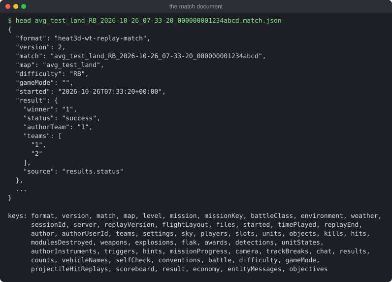

# Документот за мечот {#the-match-document}

`<match>.match.json` содржи сè што го кажува снимката, а не е ред од табелата. Табот Меч на прегледувачот го чита.

## Битката {#the-battle}

| Клуч | Што |
|---|---|
| `format`, `version` | `heat3d-wt-replay-match`, `2` |
| `match`, `map`, `level` | идот на мечот (како во името на датотеката); идот на мапата; датотеката на нивото што ја користи |
| `mission`, `missionKey` | името на мисијата и нејзиниот клуч во текстуалните датотеки на играта |
| `battleClass`, `environment`, `weather` | како што ги дава заглавието |
| `sessionId`, `server` | идот на сесијата на битката; серверот |
| `replayVersion`, `flightLayout` | верзијата на форматот на снимката; прочитаниот распоред на летачките пакети (`2025` или `2026`) |
| `files` | прочитаните датотеки на снимката (една, или деловите на серверска снимка) |
| `started`, `timePlayed`, `replayEnd` | време на почеток (ISO, UTC); одиграни секунди, од резултатите; секунди на последниот пакет на снимката |
| `author`, `authorUserId` | снимачкиот играч и неговиот Gaijin ид (клиентски снимки) |
| `teams` | тимовите во битката (`1`, `2`) |
| `result` | `winner`, `status` (`success` или `fail`, исходот на авторот), `authorTeam`, `teams` ([Економија](economy.md)) |
| `vehicleNames` | од каде дошле имињата на возилата (вашата инсталација) и нивниот јазик |
| `conventions` | единиците и знаците на табелата: оски, време, life, track, alive, roll и повеќе |

## Сè друго {#everything-else}

| Клуч | Што |
|---|---|
| `battle`, `difficulty`, `gameMode` | режимот на битката: `difficulty` `AB` / `RB` / `SB` (и неговото име, и бајтот од заглавието), `gameMode` `ground` / `air` / `naval`, режимот на мисијата (`Dom`, `Conq`, `Bttl`, `I2M`, ...) и неговото англиско име од вашата инсталација (`Domination`, `Enduring Confrontation`), дозволените типови единици (видете [Режим на битка](ground.md#battle-mode)) |
| `settings` | blk на мисијата по заглавието: режим, околина, време, ограничувања на поени и време, држави, дозволени типови единици, ветер, и `stars` (географска ширина, должина, датум, локално време) |
| `sky` | првиот `CustomWeatherParams`: насока на сонцето и месечината, ветер, бои на небото, поместувања на облаците |
| `players`, `slots` | линијата од резултатите за секој играч (убиства, копнени убиства, смрти, асистенции, поени, заземања, одред, клан, држава, состав, uid-ите што ги возел); играчките слотови на снимката (име, ид на корисник, тим) |
| `units` | секој ентитет-единица што го создала снимката: eid, uid, шаблон, возило, kind, type, тим, играч, име во мисијата, кога е создадена и отстранета, каде е создадена, кои компоненти не можеле да се прочитаат |
| `objects` | именуваните објекти на мисијата: зони за заземање и аеродроми со нивната позиција и големина, контури на аеродроми како точки, области за појавување |
| `objectives` | целите на битката, секоја со `type` (`capture_zone`, `airfield`, `helipad`, `base`, `spawn`, `convoy_spawn`, `battle_area`, `bombing_target`, `exit_zone`, `kill_area`, `rearm_zone`), `team` (1 или 2 од снимката, празно за двата), `name` (на зона за заземање нејзината буква, `A`), `shape` (`sphere`, `cylinder`, `box`, `point`, `points`, `outline`) со `position`, `radius` / `height` / `size` и `heading`, `source` (`replay` или `mission`) и што друго е познато (видете [Цели](objectives.md)) |
| `kills`, `hits`, `modulesDestroyed` | со имиња и возила на двете страни; убиствата со англиското име на оружјето |
| `weapons` | секоја ракета, проектил, бомба, торпедо, дополнителен резервоар и отфрлен товар: кога, каде е испуштено (позиција, положба, брзина), од која единица (најблиската во рок од 300 m и 1.5 s), колку примероци на лет, каде последно е видено, кога е отстрането |
| `explosions`, `flak` | `PlayExplosionVisual` (позиција, насока, kind) и `PlayFlakExplosionVisual` (позиција) |
| `awards` | наградите на снимачкиот играч (`TextStreak`: first_blood, серии, бројачи на предизвици) |
| `detections`, `unitStates` | парови единици од `UnitDetected`; порака (0xF093) со позиција, положба и брзина на единица чие значење не е познато |
| `authorInstruments` | вредностите од кабината на снимачкиот играч (`ReplayCockpitParams`) по број на инструмент, најмногу една во секунда; `known` го именува секој број што го пратила оваа снимка (име, единица, како е проверено), `notNamed` останатите |
| `scoreboard` | статистиката на секој играч секој пат кога се менувала (убиства, смрти, асистенции, поени, AI убиства, поморски убиства, зони, штета, избегнати проектили, одред), и поените на секој тим и веројатните тикети низ времето (видете [Reflection податоци](aircraft.md#reflection-data)) |
| `economy` | Silver Lions и поените за истражување од битката (видете [Економија](economy.md)): збирови, по играч, по возило, множителите, победникот, проверките |
| `entityMessages` | пораките на ентитетите (0x20) по број на класа: број, целни шаблони, големини |
| `chat` | секоја линија од разговорот |
| `triggers`, `hints`, `missionProgress` | акциите на скриптата на мисијата (RunTriggerAction), нејзините совети, нејзините пораки за напредок |
| `camera` | полињата на камерата на снимачкиот играч на секои 0.25 s како што се пратени (табелата ја има како патека) |
| `projectileHitReplays` | погодоците на снимачкиот играч и неговото погодување, со оружје и муниција и нивните англиски имиња |
| `results` | целиот blk на резултатите онака како што го напишала играта |
| `counts` | редови, настани, животи, kind-ови, примероци, ентитети по шаблон, оружја, прочитани и непрочитани пакети, секој виден ид на порака и оние што не се прочитани, испуштени примероци |
| `trackBreaks` | секој пресек на патека поради чекор побрз отколку што може единицата: каде, колку далеку, колку брзо и што е најверојатно |
| `selfCheck` | проверките наведени во [Како чита снимка](how-it-reads.md), пресметани при секое претворање; `stepSpeed` дава по kind брзина меѓу последователни редови на патека како што ги спојува прегледувачот (медијана, 99-ти перцентил, највисока, и чекори побрзи од можното, кои мора да се 0) |

---

Дел од [3DHeat](https://github.com/Holdi601/3DHeat) ([документација](https://holdi601.github.io/3DHeat/)). Извор: [3DHeat-Ext-WarThunder](https://github.com/Holdi601/3DHeat-Ext-WarThunder).
