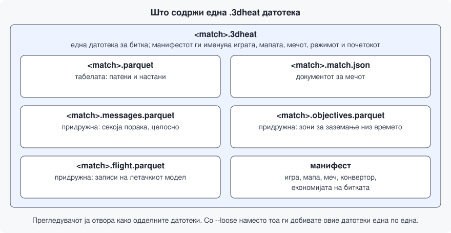
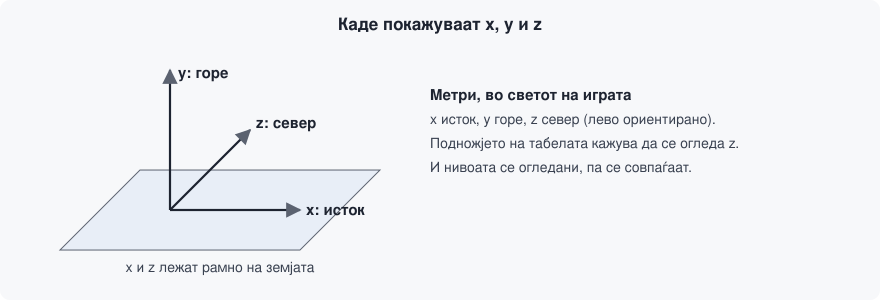

# Излезни датотеки {#output-files}

Стандардно секоја битка е **една датотека**, `out/<map>/<match>.3dheat`: табелата, документот за мечот и придружните датотеки спакувани заедно, со манифест што ги именува играта, мапата, мечот, режимот на битката, времето на почеток и конверторот (а економијата на битката е под `extensions["heat3d/economy"]`). Форматот е на прегледувачот: [Една датотека по меч (.3dheat)](https://holdi601.github.io/3DHeat/container.html).

Со `--loose` истите датотеки се пишуваат една до друга:

| Датотека | Што | Страница |
|---|---|---|
| `<match>.parquet` | еден ред за секој примерок или настан | [Табелата](table.md) |
| `<match>.match.json` | сè друго што го кажува снимката | [Документот за мечот](match-document.md) |
| `<match>.messages.parquet` | секоја порака, вредност на компонента и пакет, целосно | [Придружни датотеки](sidecars.md) |
| `<match>.objectives.parquet` | зоните за заземање низ времето | [Придружни датотеки](sidecars.md) |
| `<match>.flight.parquet` | секој запис на летачкиот модел на секој авион, целосно | [Придружни датотеки](sidecars.md) |

Ако пакувањето не успее, одделните датотеки се задржуваат и линијата го кажува тоа.

## Имиња {#names}

`<match>` е `<map>_<AB|RB|SB>_<mode>_<start, UTC>_<session id>`, како на сликата: видете [Кои датотеки се една битка](converting.md#which-files-are-one-battle). `<map>` е сопствениот ид на мапата во играта (`99_testmap` на сликите).

## Координати {#coordinates}

Метри, во сопствениот свет на играта: x исток, y горе, z север. Подножјето на табелата му кажува на прегледувачот да го огледа z, а нивоата од `heat3d-wt-level` се пишуваат на ист начин, па снимката и нејзиното ниво се совпаѓаат.

---

Дел од [3DHeat](https://github.com/Holdi601/3DHeat) ([документација](https://holdi601.github.io/3DHeat/)). Извор: [3DHeat-Ext-WarThunder](https://github.com/Holdi601/3DHeat-Ext-WarThunder).
