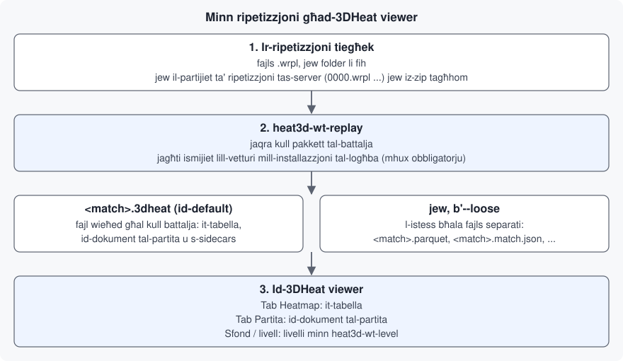

# Ripetizzjonijiet tad-3DHeat War Thunder {#dheat-war-thunder-replays}

**X'inhu?** War Thunder jista' jirrekordja battalja bħala fajl ta' ripetizzjoni. Din l-għodda
tbiddel ir-reġistrazzjoni f'fajl li tista' tara minn fuq fid-[3DHeat viewer](https://holdi601.github.io/3DHeat/),
b'kull ajruplan, tank u vapur, kull missila u bomba, u kull daqqa fejn seħħet. Kmand tieni
jbiddel il-livelli tal-installazzjoni tal-logħba tiegħek f'livelli 3D biex juru l-battaljiet fuqhom.

**Għaliex nużah?** Għal debrief ta' battalja bi 3D; għal heatmaps ta' fejn ittir, issuq,
tiġġieled u tmut int u oħrajn f'ħafna battaljiet; biex tara fejn laqtu d-daqqiet fuq vettura;
biex tara x'kellfet u x'qalgħet battalja. Il-ħruġ huwa Parquet u JSON sempliċi, għalhekk
għodod oħra jistgħu jaqrawh ukoll.

**Eżempju:** ripetizzjoni `.wrpl` waħda tidħol, fajl `<match>.3dheat` wieħed joħroġ:



## Bidu veloċi {#quick-start}

Ġdid fil-linja tal-kmandi? Aqra [Qabel ma tibda](before-you-start.md) l-ewwel.

```bash
git clone https://github.com/Holdi601/3DHeat-Ext-WarThunder.git
cd 3DHeat-Ext-WarThunder
pip install -e .                                  # installs heat3d-wt-replay and heat3d-wt-level
heat3d-wt-replay "<War Thunder>/Replays" -o out
```

Għandek tara linja waħda għal kull battalja: `ok out/<map>/<match>.3dheat`. Iftaħ dak
il-fajl fid-3DHeat viewer.

## Din id-dokumentazzjoni {#this-documentation}

| Paġna | X'tkopri |
|---|---|
| [Qabel ma tibda](before-you-start.md) | Python, terminal, u kif tkun taf li ħadem |
| [Installazzjoni](installing.md) | installa, ismijiet mill-installazzjoni tiegħek, aġġornamenti |
| [Il-konverżjoni tar-ripetizzjonijiet](converting.md) | `heat3d-wt-replay` pass pass, kull għażla, messaġġi |
| [Fajls tal-ħruġ](output-files.md) | il-fajl `.3dheat`, fajls `--loose`, ismijiet |
| [It-tabella](table.md) | kull kolonna u avveniment |
| [Id-dokument tal-partita](match-document.md) | kull ċavetta ta' `<match>.match.json` |
| [Sidecars u kompletezza](sidecars.md) | dak li jinżamm sħiħ minbarra t-tabella, u l-għadd |
| [Livelli](levels.md) | `heat3d-wt-level`: livelli mill-installazzjoni tiegħek bħala `.glb` |
| [Kif taqra ripetizzjoni](how-it-reads.md) | x'jinqara, u kif ġie kkontrollat |
| [Ajruplani](aircraft.md), [Unitajiet tal-art u kamera](ground.md), [Daqqiet, sparar u nirien](hits.md) | id-dettalji wara l-kolonni |
| [Ekonomija](economy.md), [Objettivi](objectives.md) | Silver Lions u punti tar-riċerka; żoni tal-qbid, ajrudromi |
| [Termini u liċenzja](terms.md) | it-termini ta' Gaijin, sorsi, testijiet, liċenzja |
| [Referenza tal-kmandi](../cli-reference.md), [Lista tal-kolonni](../columns.md) | iġġenerati mill-kodiċi |

## Parti mid-3DHeat {#part-of-3dheat}

Dan il-konvertitur huwa wieħed mill-għodod tad-[3DHeat](https://github.com/Holdi601/3DHeat),
viewer 3D ta' telemetrija u ripetizzjoni fil-ħin reali ([dokumentazzjoni](https://holdi601.github.io/3DHeat/)).
Il-viewer jiftaħ il-fajl `.3dheat`: it-tabella fit-tab Heatmap tiegħu, id-dokument tal-partita
fit-tab Partita tiegħu ([Fajl wieħed għal kull partita](https://holdi601.github.io/3DHeat/container.html)).
X'għandu jżomm kull konvertitur: [Il-konvertituri jżommu kollox](https://holdi601.github.io/3DHeat/converters.html).

**Għaliex hija għodda separata.** Il-format `.wrpl` mhuwiex iddokumentat, u l-EULA ta' Gaijin
(3.2.2, 3.2.9) tipprojbixxi r-reverse engineering tal-logħba u l-estrazzjoni ta' data li mhix
maħsuba biex turi; ma ssemmix ripetizzjonijiet, li l-logħba nnifisha turi lill-plejer. Biex
mistoqsija ta' liċenzja tmiss lil dan il-konvertitur biss, jgħix barra mid-3DHeat Watcher: il-Watcher
iħaddmu fuq ripetizzjonijiet ġodda meta jkun installat, u jaħdem mingħajru.

| Għodda | X'tagħmel | Sors | Dokumentazzjoni |
|---|---|---|---|
| 3DHeat viewer | juri d-data bi 3D: heatmaps, ripetizzjonijiet, analiżi tat-tellieqa | [3DHeat](https://github.com/Holdi601/3DHeat) | [sit](https://holdi601.github.io/3DHeat/) |
| GameFiles | korsijiet u livelli mill-fajls li jiġu mal-logħob | [3DHeat-GameFiles](https://github.com/Holdi601/3DHeat-GameFiles) | [sit](https://holdi601.github.io/3DHeat-GameFiles/) |
| GameCapture | telemetrija tal-gir, u livelli mibnija mill-vidjo tal-logħob | [3DHeat-GameCapture](https://github.com/Holdi601/3DHeat-GameCapture) | [sit](https://holdi601.github.io/3DHeat-GameCapture/) |
| Unreal Exporter | plugin tal-Unreal Editor li jesporta livell | [3DHeat-UnrealExporter](https://github.com/Holdi601/3DHeat-UnrealExporter) | [sit](https://holdi601.github.io/3DHeat-UnrealExporter/) |
| CS2 | demos u mapep ta' Counter-Strike 2 | [3DHeat-CS2](https://github.com/Holdi601/3DHeat-CS2) | [sit](https://holdi601.github.io/3DHeat-CS2/) |
| Watcher | jirrekordja dak li l-logħob jippubblika waqt li tilgħab | [3DHeat-Watcher](https://github.com/Holdi601/3DHeat-Watcher) | [sit](https://holdi601.github.io/3DHeat-Watcher/) |
| Ripetizzjonijiet ta' War Thunder | ripetizzjonijiet `.wrpl` u livelli ta' War Thunder | [3DHeat-Ext-WarThunder](https://github.com/Holdi601/3DHeat-Ext-WarThunder) | [sit](https://holdi601.github.io/3DHeat-Ext-WarThunder/) |
| Ripetizzjonijiet ta' World of Tanks | ripetizzjonijiet `.wotreplay` | [3DHeat-Ext-WoT](https://github.com/Holdi601/3DHeat-Ext-WoT) | [sit](https://holdi601.github.io/3DHeat-Ext-WoT/) |
| Ripetizzjonijiet ta' World of Warships | ripetizzjonijiet `.wowsreplay` | [3DHeat-Ext-WoWs](https://github.com/Holdi601/3DHeat-Ext-WoWs) | [sit](https://holdi601.github.io/3DHeat-Ext-WoWs/) |
| Demos ta' Squad | demos tas-server ta' Squad | [3DHeat-Ext-Squad](https://github.com/Holdi601/3DHeat-Ext-Squad) | [sit](https://holdi601.github.io/3DHeat-Ext-Squad/) |
| Mapep ta' DCS | mapep ta' DCS World bħala livelli 3D | [3DHeat-Ext-DCS](https://github.com/Holdi601/3DHeat-Ext-DCS) | [sit](https://holdi601.github.io/3DHeat-Ext-DCS/) |
| Mapep ta' IL-2 | mapep ta' IL-2 Great Battles bħala livelli 3D | [3DHeat-Ext-IL2](https://github.com/Holdi601/3DHeat-Ext-IL2) | [sit](https://holdi601.github.io/3DHeat-Ext-IL2/) |

---

Parti mid-[3DHeat](https://github.com/Holdi601/3DHeat) ([dokumentazzjoni](https://holdi601.github.io/3DHeat/)). Sors: [3DHeat-Ext-WarThunder](https://github.com/Holdi601/3DHeat-Ext-WarThunder).
