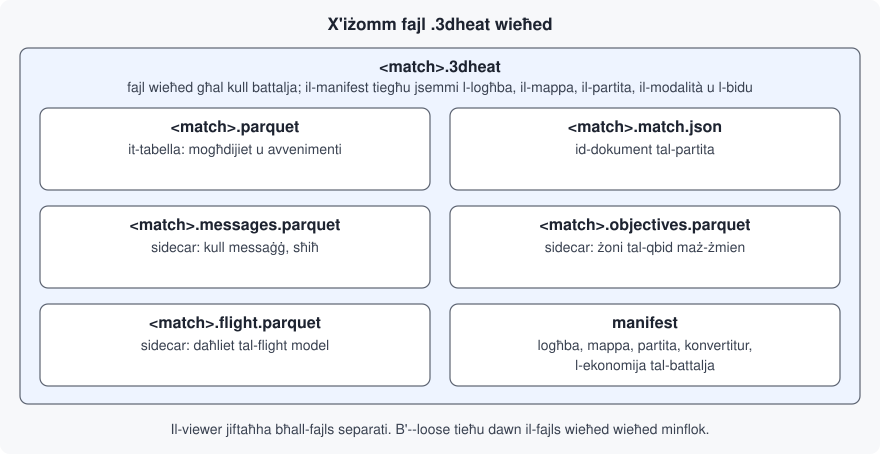
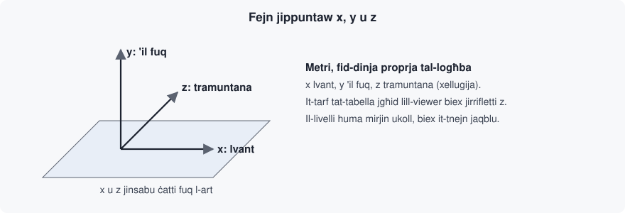

# Fajls tal-ħruġ {#output-files}

B'mod default kull battalja hija **fajl wieħed**, `out/<map>/<match>.3dheat`: it-tabella,
id-dokument tal-partita u s-sidecars ippakkjati flimkien, b'manifest li jsemmi l-logħba, il-mappa,
il-partita, il-modalità tal-battalja, il-ħin tal-bidu u l-konvertitur (u l-ekonomija tal-battalja
taħt `extensions["heat3d/economy"]`). Il-format huwa tal-viewer:
[Fajl wieħed għal kull partita (.3dheat)](https://holdi601.github.io/3DHeat/container.html).

B'`--loose` l-istess fajls jinkitbu ħdejn xulxin minflok:

| Fajl | X'inhu | Paġna |
|---|---|---|
| `<match>.parquet` | ringiela waħda għal kull kampjun jew avveniment | [It-tabella](table.md) |
| `<match>.match.json` | kull ħaġa oħra li tgħid ir-ripetizzjoni | [Id-dokument tal-partita](match-document.md) |
| `<match>.messages.parquet` | kull messaġġ, valur ta' komponent u pakkett, sħaħ | [Sidecars](sidecars.md) |
| `<match>.objectives.parquet` | iż-żoni tal-qbid maż-żmien | [Sidecars](sidecars.md) |
| `<match>.flight.parquet` | kull daħla tal-flight model ta' kull ajruplan, sħiħa | [Sidecars](sidecars.md) |

Jekk l-ippakkjar jfalli, il-fajls separati jinżammu u l-linja tgħid hekk.

## Ismijiet {#names}

`<match>` huwa `<map>_<AB|RB|SB>_<mode>_<start, UTC>_<session id>`, kif fl-istampa:
ara [Liema fajls huma battalja waħda](converting.md#which-files-are-one-battle).
`<map>` huwa l-id proprju tal-logħba tal-mappa (`99_testmap` fl-istampi).

## Koordinati {#coordinates}

Metri, fid-dinja proprja tal-logħba: x lvant, y 'il fuq, z tramuntana. It-tarf tat-tabella
jgħid lill-viewer biex jirrifletti z, u l-livelli minn `heat3d-wt-level` jinkitbu bl-istess
mod, biex ripetizzjoni u l-livell tagħha jinsabu waħda fuq l-oħra.

---

Parti mid-[3DHeat](https://github.com/Holdi601/3DHeat) ([dokumentazzjoni](https://holdi601.github.io/3DHeat/)). Sors: [3DHeat-Ext-WarThunder](https://github.com/Holdi601/3DHeat-Ext-WarThunder).
