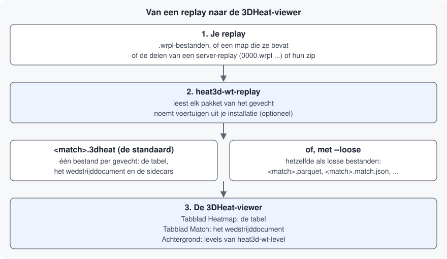

# 3DHeat War Thunder-replays {#dheat-war-thunder-replays}

**Wat is het?** War Thunder kan een gevecht opnemen als replay-bestand. Deze tool
maakt van die opname een bestand dat je van bovenaf kunt bekijken in de
[3DHeat-viewer](https://holdi601.github.io/3DHeat/), met elk vliegtuig, elke tank
en elk schip, elke raket en bom, en elke treffer op de plek waar hij viel. Een tweede
commando maakt van de levels van je eigen gameinstallatie 3D-levels waarop de
gevechten getoond worden.

**Waarom zou ik het gebruiken?** Voor een nabespreking van een gevecht in 3D; voor
heatmaps van waar jij en anderen vliegen, rijden, vechten en sneuvelen, over veel
gevechten heen; om te zien waar treffers op een voertuig terechtkwamen; om te zien wat
een gevecht kostte en opleverde. De uitvoer is gewoon Parquet en JSON, dus andere
tools kunnen die ook lezen.

**Voorbeeld:** één `.wrpl`-replay erin, één `<match>.3dheat`-bestand eruit:



## Snelle start {#quick-start}

Nieuw met de opdrachtregel? Lees eerst [Voordat je begint](before-you-start.md).

```bash
git clone https://github.com/Holdi601/3DHeat-Ext-WarThunder.git
cd 3DHeat-Ext-WarThunder
pip install -e .                                  # installeert heat3d-wt-replay en heat3d-wt-level
heat3d-wt-replay "<War Thunder>/Replays" -o out
```

Je ziet één regel per gevecht: `ok out/<map>/<match>.3dheat`. Open dat
bestand in de 3DHeat-viewer.

## Deze documentatie {#this-documentation}

| Pagina | Wat erin staat |
|---|---|
| [Voordat je begint](before-you-start.md) | Python, een terminal en wat succes betekent |
| [Installeren](installing.md) | installeren, namen uit je installatie, updates |
| [Replays omzetten](converting.md) | `heat3d-wt-replay` stap voor stap, elke optie, berichten |
| [Uitvoerbestanden](output-files.md) | het `.3dheat`-bestand, `--loose`-bestanden, namen |
| [De tabel](table.md) | elke kolom en elke gebeurtenis |
| [Het wedstrijddocument](match-document.md) | elke sleutel van `<match>.match.json` |
| [Sidecars en volledigheid](sidecars.md) | wat naast de tabel volledig bewaard blijft, en de tellingen |
| [Levels](levels.md) | `heat3d-wt-level`: levels uit je installatie als `.glb` |
| [Hoe het een replay leest](how-it-reads.md) | wat er gelezen wordt, en hoe het gecontroleerd is |
| [Vliegtuigen](aircraft.md), [Grondeenheden en camera](ground.md), [Treffers, beschieting en branden](hits.md) | de details achter de kolommen |
| [Economie](economy.md), [Doelen](objectives.md) | Zilveren Leeuwen en onderzoekspunten; veroveringszones, vliegvelden |
| [Voorwaarden en licentie](terms.md) | de voorwaarden van Gaijin, bronnen, tests, licentie |
| [Opdrachtreferentie](../cli-reference.md), [Kolomlijst](../columns.md) | gegenereerd uit de code |

## Onderdeel van 3DHeat {#part-of-3dheat}

Deze converter is een van de tools van [3DHeat](https://github.com/Holdi601/3DHeat),
een realtime 3D-viewer voor telemetrie en replays ([documentatie](https://holdi601.github.io/3DHeat/)).
De viewer opent het `.3dheat`-bestand: de tabel in het tabblad Heatmap, het
wedstrijddocument in het tabblad Match ([Eén bestand per wedstrijd](https://holdi601.github.io/3DHeat/container.html)).
Wat elke converter moet bewaren: [Converters bewaren alles](https://holdi601.github.io/3DHeat/converters.html).

**Waarom het een aparte tool is.** Het `.wrpl`-formaat is niet gedocumenteerd, en
de EULA van Gaijin (3.2.2, 3.2.9) verbiedt het reverse engineeren van het spel en
het opgraven van gegevens die niet bedoeld zijn om getoond te worden; er staat geen
woord over replays, die het spel zelf aan de speler laat zien. Zodat een licentievraag
alleen deze converter raakt, staat hij buiten de 3DHeat Watcher: de Watcher draait hem op
nieuwe replays als hij geïnstalleerd is, en werkt ook zonder hem.

| Tool | Wat hij doet | Bron | Documentatie |
|---|---|---|---|
| 3DHeat-viewer | toont de gegevens in 3D: heatmaps, replays, race-analyse | [3DHeat](https://github.com/Holdi601/3DHeat) | [site](https://holdi601.github.io/3DHeat/) |
| GameFiles | banen en levels uit de bestanden die games meeleveren | [3DHeat-GameFiles](https://github.com/Holdi601/3DHeat-GameFiles) | [site](https://holdi601.github.io/3DHeat-GameFiles/) |
| GameCapture | rondetelemetrie, en levels die uit gameplayvideo zijn nagebouwd | [3DHeat-GameCapture](https://github.com/Holdi601/3DHeat-GameCapture) | [site](https://holdi601.github.io/3DHeat-GameCapture/) |
| Unreal Exporter | een plug-in voor de Unreal Editor die een level exporteert | [3DHeat-UnrealExporter](https://github.com/Holdi601/3DHeat-UnrealExporter) | [site](https://holdi601.github.io/3DHeat-UnrealExporter/) |
| CS2 | Counter-Strike 2-demo's en -kaarten | [3DHeat-CS2](https://github.com/Holdi601/3DHeat-CS2) | [site](https://holdi601.github.io/3DHeat-CS2/) |
| Watcher | legt vast wat games publiceren terwijl je speelt | [3DHeat-Watcher](https://github.com/Holdi601/3DHeat-Watcher) | [site](https://holdi601.github.io/3DHeat-Watcher/) |
| War Thunder-replays | `.wrpl`-replays en War Thunder-levels | [3DHeat-Ext-WarThunder](https://github.com/Holdi601/3DHeat-Ext-WarThunder) | [site](https://holdi601.github.io/3DHeat-Ext-WarThunder/) |
| World of Tanks-replays | `.wotreplay`-replays | [3DHeat-Ext-WoT](https://github.com/Holdi601/3DHeat-Ext-WoT) | [site](https://holdi601.github.io/3DHeat-Ext-WoT/) |
| World of Warships-replays | `.wowsreplay`-replays | [3DHeat-Ext-WoWs](https://github.com/Holdi601/3DHeat-Ext-WoWs) | [site](https://holdi601.github.io/3DHeat-Ext-WoWs/) |
| Squad-demo's | demo's van Squad-servers | [3DHeat-Ext-Squad](https://github.com/Holdi601/3DHeat-Ext-Squad) | [site](https://holdi601.github.io/3DHeat-Ext-Squad/) |
| DCS-kaarten | DCS World-kaarten als 3D-levels | [3DHeat-Ext-DCS](https://github.com/Holdi601/3DHeat-Ext-DCS) | [site](https://holdi601.github.io/3DHeat-Ext-DCS/) |
| IL-2-kaarten | IL-2 Great Battles-kaarten als 3D-levels | [3DHeat-Ext-IL2](https://github.com/Holdi601/3DHeat-Ext-IL2) | [site](https://holdi601.github.io/3DHeat-Ext-IL2/) |

---

Onderdeel van [3DHeat](https://github.com/Holdi601/3DHeat) ([documentatie](https://holdi601.github.io/3DHeat/)). Bron: [3DHeat-Ext-WarThunder](https://github.com/Holdi601/3DHeat-Ext-WarThunder).
