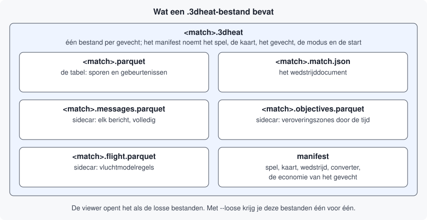
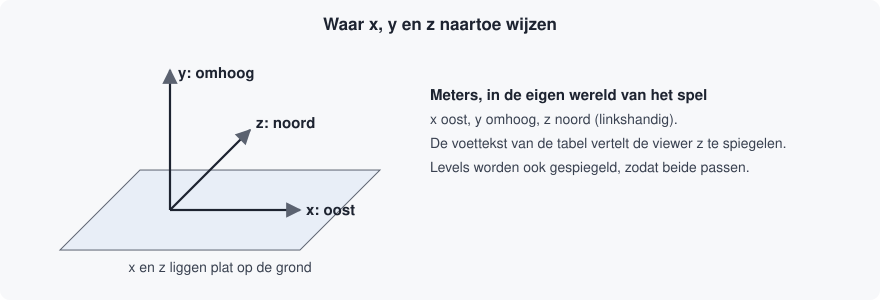

# Uitvoerbestanden {#output-files}

Standaard is elk gevecht **één bestand**, `out/<map>/<match>.3dheat`: de
tabel, het wedstrijddocument en de sidecars samen ingepakt, met een manifest
dat het spel, de kaart, de wedstrijd, de gevechtsmodus, de starttijd en de converter
noemt (en de economie van het gevecht onder `extensions["heat3d/economy"]`). Het formaat is dat
van de viewer: [Eén bestand per wedstrijd (.3dheat)](https://holdi601.github.io/3DHeat/container.html).

Met `--loose` worden dezelfde bestanden naast elkaar geschreven:

| Bestand | Wat | Pagina |
|---|---|---|
| `<match>.parquet` | één rij per sample of gebeurtenis | [De tabel](table.md) |
| `<match>.match.json` | al het andere wat de replay vertelt | [Het wedstrijddocument](match-document.md) |
| `<match>.messages.parquet` | elk bericht, elke componentwaarde en elk pakket, volledig | [Sidecars](sidecars.md) |
| `<match>.objectives.parquet` | de veroveringszones door de tijd heen | [Sidecars](sidecars.md) |
| `<match>.flight.parquet` | elke vluchtmodelregel van elk vliegtuig, volledig | [Sidecars](sidecars.md) |

Mislukt het inpakken, dan blijven de losse bestanden bewaard en de regel zegt dat.

## Namen {#names}

`<match>` is `<map>_<AB|RB|SB>_<mode>_<start, UTC>_<sessie-id>`, zoals op de
afbeelding: zie [Welke bestanden horen bij één gevecht](converting.md#which-files-are-one-battle).
`<map>` is de eigen id van het spel voor de kaart (`99_testmap` op de afbeeldingen).

## Coördinaten {#coordinates}

In meters, in de eigen wereld van het spel: x oost, y omhoog, z noord. De voettekst van de
tabel vertelt de viewer om z te spiegelen, en levels van `heat3d-wt-level` worden
op dezelfde manier geschreven, zodat een replay en zijn level precies op elkaar liggen.

---

Onderdeel van [3DHeat](https://github.com/Holdi601/3DHeat) ([documentatie](https://holdi601.github.io/3DHeat/)). Bron: [3DHeat-Ext-WarThunder](https://github.com/Holdi601/3DHeat-Ext-WarThunder).
