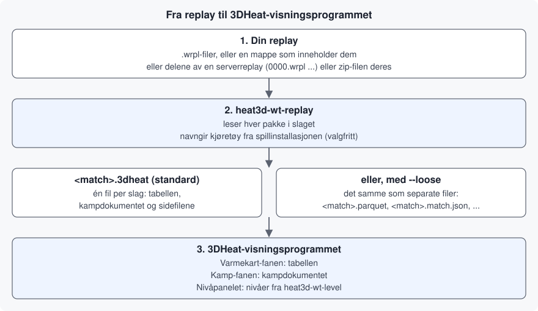

# 3DHeat-replayer fra War Thunder {#dheat-war-thunder-replays}

**Hva er det?** War Thunder kan ta opp et slag som en replay-fil. Dette
verktøyet gjør opptaket om til en fil du kan se ovenfra i
[3DHeat-visningsprogrammet](https://holdi601.github.io/3DHeat/), med hvert fly,
stridsvogn og skip, hver rakett og bombe, og hvert treff der det skjedde. En
andre kommando gjør nivåene i din egen spillinstallasjon om til 3D-nivåer som
slagene vises på.

**Hvorfor skulle jeg bruke det?** For en gjennomgang av et slag i 3D; for
varmekart over hvor du og andre flyr, kjører, kjemper og dør over mange slag;
for å se hvor treffene traff et kjøretøy; for å se hva et slag kostet og
tjente. Resultatet er vanlig Parquet og JSON, så andre verktøy kan lese det
også.

**Eksempel:** én `.wrpl`-replay inn, én `<kamp>.3dheat`-fil ut:



## Hurtigstart {#quick-start}

Ny på kommandolinjen? Les [Før du starter](before-you-start.md) først.

```bash
git clone https://github.com/Holdi601/3DHeat-Ext-WarThunder.git
cd 3DHeat-Ext-WarThunder
pip install -e .                                  # installerer heat3d-wt-replay og heat3d-wt-level
heat3d-wt-replay "<War Thunder>/Replays" -o out
```

Du bør se én linje per slag: `ok out/<kart>/<kamp>.3dheat`. Åpne den filen i
3DHeat-visningsprogrammet.

## Denne dokumentasjonen {#this-documentation}

| Side | Hva den dekker |
|---|---|
| [Før du starter](before-you-start.md) | Python, en terminal, og hva suksess ser ut som |
| [Installere](installing.md) | installasjon, navn fra installasjonen din, oppdateringer |
| [Konvertere replayer](converting.md) | `heat3d-wt-replay` steg for steg, alle valg, meldinger |
| [Utdatafiler](output-files.md) | `.3dheat`-filen, `--loose`-filer, navn |
| [Tabellen](table.md) | hver kolonne og hver hendelse |
| [Kampdokumentet](match-document.md) | hver nøkkel i `<kamp>.match.json` |
| [Sidefiler og fullstendighet](sidecars.md) | hva som beholdes helt ved siden av tabellen, og tellingene |
| [Nivåer](levels.md) | `heat3d-wt-level`: nivåer fra installasjonen din som `.glb` |
| [Slik leser den en replay](how-it-reads.md) | hva som leses, og hvordan det ble kontrollert |
| [Fly](aircraft.md), [Bakkeenheter og kamera](ground.md), [Treff, skuddild og branner](hits.md) | detaljene bak kolonnene |
| [Økonomi](economy.md), [Mål](objectives.md) | Silver Lions og forskningspoeng; erobringssoner, flyplasser |
| [Vilkår og lisens](terms.md) | Gaijins vilkår, kilder, tester, lisens |
| [Kommandoreferanse](../cli-reference.md), [Kolonneliste](../columns.md) | generert fra koden |

## Del av 3DHeat {#part-of-3dheat}

Denne konverteren er et av verktøyene i [3DHeat](https://github.com/Holdi601/3DHeat),
en sanntids 3D-visning for telemetri og replayer ([dokumentasjon](https://holdi601.github.io/3DHeat/)).
Visningsprogrammet åpner `.3dheat`-filen: tabellen i fanen Varmekart, og
kampdokumentet i fanen Kamp ([Én fil per kamp](https://holdi601.github.io/3DHeat/container.html)).
Det hver konverter må beholde: [Konvertere beholder alt](https://holdi601.github.io/3DHeat/converters.html).

**Hvorfor det er et eget verktøy.** `.wrpl`-formatet er ikke dokumentert, og
Gaijins EULA (3.2.2, 3.2.9) forbyr baklengs utvikling av spillet og innhenting
av data som ikke er ment å vises; den nevner ikke replayer, som spillet selv
viser spilleren. Slik at et lisensspørsmål bare rører denne konverteren, ligger
den utenfor 3DHeat Watcher: Watcher kjører den på nye replayer når den er
installert, og fungerer uten den.

| Verktøy | Hva det gjør | Kilde | Dokumentasjon |
|---|---|---|---|
| 3DHeat-visningsprogrammet | viser dataene i 3D: varmekart, replayer, løpsanalyse | [3DHeat](https://github.com/Holdi601/3DHeat) | [nettsted](https://holdi601.github.io/3DHeat/) |
| GameFiles | kurs og nivåer fra filene spill leveres med | [3DHeat-GameFiles](https://github.com/Holdi601/3DHeat-GameFiles) | [nettsted](https://holdi601.github.io/3DHeat-GameFiles/) |
| GameCapture | runde-telemetri, og nivåer bygget opp fra spillvideo | [3DHeat-GameCapture](https://github.com/Holdi601/3DHeat-GameCapture) | [nettsted](https://holdi601.github.io/3DHeat-GameCapture/) |
| Unreal Exporter | en plugin for Unreal Editor som eksporterer et nivå | [3DHeat-UnrealExporter](https://github.com/Holdi601/3DHeat-UnrealExporter) | [nettsted](https://holdi601.github.io/3DHeat-UnrealExporter/) |
| CS2 | Counter-Strike 2-demoer og kart | [3DHeat-CS2](https://github.com/Holdi601/3DHeat-CS2) | [nettsted](https://holdi601.github.io/3DHeat-CS2/) |
| Watcher | tar opp det spill publiserer mens du spiller | [3DHeat-Watcher](https://github.com/Holdi601/3DHeat-Watcher) | [nettsted](https://holdi601.github.io/3DHeat-Watcher/) |
| War Thunder-replayer | `.wrpl`-replayer og War Thunder-nivåer | [3DHeat-Ext-WarThunder](https://github.com/Holdi601/3DHeat-Ext-WarThunder) | [nettsted](https://holdi601.github.io/3DHeat-Ext-WarThunder/) |
| World of Tanks-replayer | `.wotreplay`-replayer | [3DHeat-Ext-WoT](https://github.com/Holdi601/3DHeat-Ext-WoT) | [nettsted](https://holdi601.github.io/3DHeat-Ext-WoT/) |
| World of Warships-replayer | `.wowsreplay`-replayer | [3DHeat-Ext-WoWs](https://github.com/Holdi601/3DHeat-Ext-WoWs) | [nettsted](https://holdi601.github.io/3DHeat-Ext-WoWs/) |
| Squad-demoer | demoer fra Squad-servere | [3DHeat-Ext-Squad](https://github.com/Holdi601/3DHeat-Ext-Squad) | [nettsted](https://holdi601.github.io/3DHeat-Ext-Squad/) |
| DCS-kart | DCS World-kart som 3D-nivåer | [3DHeat-Ext-DCS](https://github.com/Holdi601/3DHeat-Ext-DCS) | [nettsted](https://holdi601.github.io/3DHeat-Ext-DCS/) |
| IL-2-kart | IL-2 Great Battles-kart som 3D-nivåer | [3DHeat-Ext-IL2](https://github.com/Holdi601/3DHeat-Ext-IL2) | [nettsted](https://holdi601.github.io/3DHeat-Ext-IL2/) |

---

Del av [3DHeat](https://github.com/Holdi601/3DHeat) ([dokumentasjon](https://holdi601.github.io/3DHeat/)). Kilde: [3DHeat-Ext-WarThunder](https://github.com/Holdi601/3DHeat-Ext-WarThunder).
