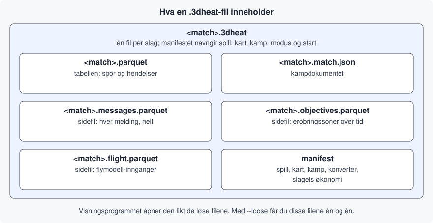
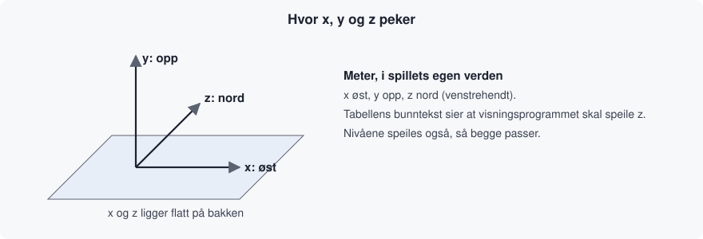

# Utdatafiler {#output-files}

Som standard er hvert slag **én fil**, `out/<kart>/<kamp>.3dheat`: tabellen, kampdokumentet
og sidefilene pakket sammen, med et manifest som navngir spillet, kartet, kampen, slagmodusen, starttiden og
konverteren (og slagets økonomi under `extensions["heat3d/economy"]`). Formatet er visningsprogrammets:
[Én fil per kamp (.3dheat)](https://holdi601.github.io/3DHeat/container.html).

Med `--loose` skrives de samme filene side om side i stedet:

| Fil | Hva | Side |
|---|---|---|
| `<kamp>.parquet` | én rad per sample eller hendelse | [Tabellen](table.md) |
| `<kamp>.match.json` | alt annet replayen sier | [Kampdokumentet](match-document.md) |
| `<kamp>.messages.parquet` | hver melding, komponentverdi og pakke, helt | [Sidefiler](sidecars.md) |
| `<kamp>.objectives.parquet` | erobringssonene over tid | [Sidefiler](sidecars.md) |
| `<kamp>.flight.parquet` | hver flymodell-inngang for hvert fly, helt | [Sidefiler](sidecars.md) |

Hvis pakkingen mislykkes, beholdes de løse filene, og linjen sier det.

## Navn {#names}

`<kamp>` er `<kart>_<AB|RB|SB>_<modus>_<start, UTC>_<økt-id>`, som på bildet: se
[Hvilke filer er ett slag](converting.md#which-files-are-one-battle).
`<kart>` er spillets egen ID for kartet (`99_testmap` i bildene).

## Koordinater {#coordinates}

Meter, i spillets egen verden: x øst, y opp, z nord. Tabellens bunntekst forteller
visningsprogrammet at det skal speile z, og nivåer fra `heat3d-wt-level` skrives på samme måte,
så en replay og dens nivå ligger oppå hverandre.

---

Del av [3DHeat](https://github.com/Holdi601/3DHeat) ([dokumentasjon](https://holdi601.github.io/3DHeat/)). Kilde: [3DHeat-Ext-WarThunder](https://github.com/Holdi601/3DHeat-Ext-WarThunder).
