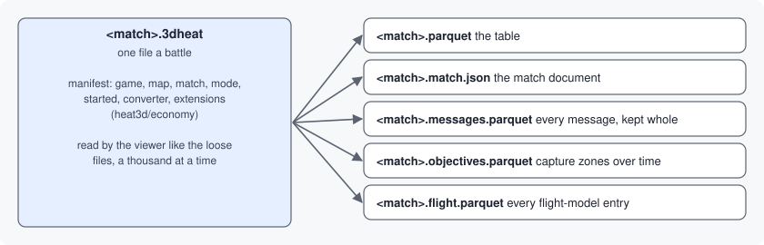
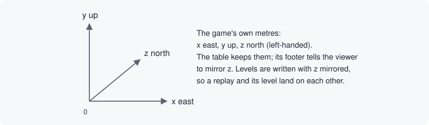

# Output files

By default each battle is **one file**, `out/<map>/<match>.3dheat`: the
table, the match document and the sidecars packed together, with a manifest
naming the game, map, match, battle mode, start time and converter (and the
battle's economy under `extensions["heat3d/economy"]`). The format is the
viewer's: [One file a match (.3dheat)](https://holdi601.github.io/3DHeat/container.html).

With `--loose` the same files are written side by side instead:

| File | What | Page |
|---|---|---|
| `<match>.parquet` | one row per sample or event | [The table](table.md) |
| `<match>.match.json` | everything else the replay says | [The match document](match-document.md) |
| `<match>.messages.parquet` | every message, component value and packet, whole | [Sidecars](sidecars.md) |
| `<match>.objectives.parquet` | the capture zones over time | [Sidecars](sidecars.md) |
| `<match>.flight.parquet` | every flight-model entry of every aircraft, whole | [Sidecars](sidecars.md) |

If packing fails, the loose files are kept and the line says so.

## Names

`<match>` is `<map>_<AB|RB|SB>_<mode>_<start, UTC>_<session id>`, as in the
picture: see [Which files are one battle](converting.md#which-files-are-one-battle).

## Coordinates

---

Part of [3DHeat](https://github.com/Holdi601/3DHeat) ([documentation](https://holdi601.github.io/3DHeat/)). Source: [3DHeat-Ext-WarThunder](https://github.com/Holdi601/3DHeat-Ext-WarThunder).
