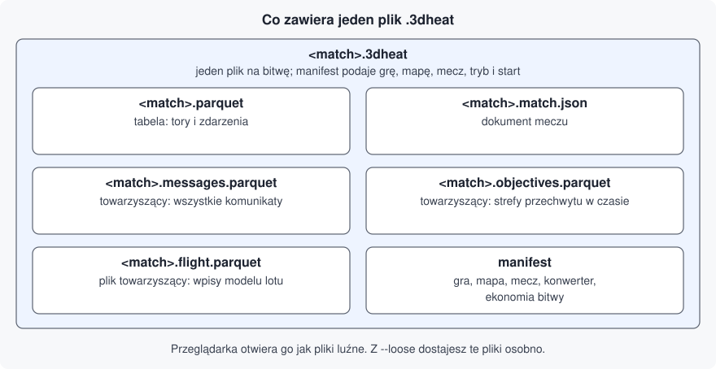
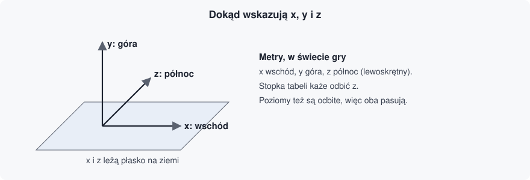

# Pliki wyjściowe {#output-files}

Domyślnie każda bitwa to **jeden plik**, `out/<map>/<match>.3dheat`: tabela,
dokument meczu i pliki towarzyszące spakowane razem, z manifestem
podającym grę, mapę, mecz, tryb bitwy, czas startu i konwerter (a ekonomię
bitwy w `extensions["heat3d/economy"]`). Format należy do przeglądarki:
[Jeden plik na mecz (.3dheat)](https://holdi601.github.io/3DHeat/container.html).

Z `--loose` zamiast tego te same pliki zapisują się obok siebie:

| Plik | Co to jest | Strona |
|---|---|---|
| `<match>.parquet` | jeden wiersz na próbkę lub zdarzenie | [Tabela](table.md) |
| `<match>.match.json` | wszystko inne, co mówi replay | [Dokument meczu](match-document.md) |
| `<match>.messages.parquet` | każdy komunikat, wartość komponentu i pakiet, w całości | [Pliki towarzyszące](sidecars.md) |
| `<match>.objectives.parquet` | strefy przechwytu w czasie | [Pliki towarzyszące](sidecars.md) |
| `<match>.flight.parquet` | każdy wpis modelu lotu każdego samolotu, w całości | [Pliki towarzyszące](sidecars.md) |

Jeśli spakowanie się nie uda, pliki luźne zostają, a wiersz to mówi.

## Nazwy {#names}

`<match>` to `<map>_<AB|RB|SB>_<mode>_<start, UTC>_<session id>`, jak na
obrazku: zob. [Które pliki to jedna bitwa](converting.md#which-files-are-one-battle).
`<map>` to własny identyfikator mapy w grze (`99_testmap` na obrazkach).

## Współrzędne {#coordinates}

Metry, w świecie samej gry: x na wschód, y w górę, z na północ. Stopka tabeli
mówi przeglądarce, żeby odbiła z, a poziomy z `heat3d-wt-level` zapisują się
w ten sam sposób, więc replay i jego poziom leżą jeden na drugim.

---

Część [3DHeat](https://github.com/Holdi601/3DHeat) ([dokumentacja](https://holdi601.github.io/3DHeat/)). Źródło: [3DHeat-Ext-WarThunder](https://github.com/Holdi601/3DHeat-Ext-WarThunder).
