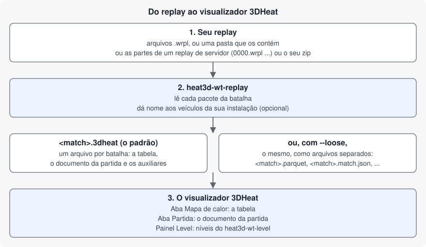

# Replays de War Thunder no 3DHeat {#dheat-war-thunder-replays}

**O que é?** O War Thunder pode gravar uma batalha como arquivo de replay. Esta
ferramenta transforma a gravação num arquivo que você pode assistir de cima no
[visualizador 3DHeat](https://holdi601.github.io/3DHeat/), com cada avião, tanque
e navio, cada míssil e bomba, e cada acerto no lugar onde aconteceu. Um segundo
comando transforma os níveis da sua própria instalação do jogo em níveis 3D para
mostrar as batalhas.

**Para que serve?** Para rever uma batalha em 3D; para mapas de calor de onde você
e outros voam, dirigem, lutam e morrem em muitas batalhas; para ver onde os
acertos atingiram um veículo; para ver quanto uma batalha custou e rendeu. A saída
é Parquet e JSON simples, então outras ferramentas também conseguem ler.

**Exemplo:** um replay `.wrpl` entra, um arquivo `<match>.3dheat` sai:



## Início rápido {#quick-start}

Nunca usou a linha de comando? Leia primeiro [Antes de começar](before-you-start.md).

```bash
git clone https://github.com/Holdi601/3DHeat-Ext-WarThunder.git
cd 3DHeat-Ext-WarThunder
pip install -e .                                  # instala heat3d-wt-replay e heat3d-wt-level
heat3d-wt-replay "<War Thunder>/Replays" -o out
```

Você deve ver uma linha por batalha: `ok out/<map>/<match>.3dheat`. Abra esse
arquivo no visualizador 3DHeat.

## Esta documentação {#this-documentation}

| Página | O que traz |
|---|---|
| [Antes de começar](before-you-start.md) | Python, um terminal e como é um resultado de sucesso |
| [Instalação](installing.md) | instalar, nomes da sua instalação, atualizações |
| [Converter replays](converting.md) | `heat3d-wt-replay` passo a passo, cada opção, mensagens |
| [Arquivos de saída](output-files.md) | o arquivo `.3dheat`, arquivos `--loose`, nomes |
| [A tabela](table.md) | cada coluna e cada evento |
| [O documento da partida](match-document.md) | cada chave de `<match>.match.json` |
| [Arquivos auxiliares e completude](sidecars.md) | o que é guardado inteiro além da tabela, e as contagens |
| [Níveis](levels.md) | `heat3d-wt-level`: níveis da sua instalação como `.glb` |
| [Como lê um replay](how-it-reads.md) | o que é lido, e como foi verificado |
| [Aviões](aircraft.md), [Unidades terrestres e câmera](ground.md), [Acertos, tiros e incêndios](hits.md) | os detalhes por trás das colunas |
| [Economia](economy.md), [Objetivos](objectives.md) | Leões de Prata e pontos de pesquisa; zonas de captura, aeródromos |
| [Termos e licença](terms.md) | termos da Gaijin, fontes, testes, licença |
| [Referência de comandos](../cli-reference.md), [Lista de colunas](../columns.md) | gerados a partir do código |

## Parte do 3DHeat {#part-of-3dheat}

Este conversor é uma das ferramentas do [3DHeat](https://github.com/Holdi601/3DHeat),
um visualizador de telemetria e replays 3D em tempo real ([documentação](https://holdi601.github.io/3DHeat/)).
O visualizador abre o arquivo `.3dheat`: a tabela na sua aba Mapa de calor, o
documento da partida na sua aba Partida ([Um arquivo por partida](https://holdi601.github.io/3DHeat/container.html)).
O que todo conversor precisa manter: [Conversores mantêm tudo](https://holdi601.github.io/3DHeat/converters.html).

**Por que é uma ferramenta separada.** O formato `.wrpl` não é documentado, e o
EULA da Gaijin (3.2.2, 3.2.9) proíbe a engenharia reversa do jogo e a mineração de
dados que não se destinam a ser mostrados; ele não menciona replays, que o próprio
jogo mostra ao jogador. Assim, uma dúvida de licença toca apenas este conversor, que
fica fora do 3DHeat Watcher: o Watcher o executa nos replays novos quando está
instalado, e funciona sem ele.

| Ferramenta | O que faz | Código | Documentação |
|---|---|---|---|
| Visualizador 3DHeat | mostra os dados em 3D: mapas de calor, replays, análise de corrida | [3DHeat](https://github.com/Holdi601/3DHeat) | [site](https://holdi601.github.io/3DHeat/) |
| GameFiles | percursos e níveis extraídos dos arquivos que os jogos trazem | [3DHeat-GameFiles](https://github.com/Holdi601/3DHeat-GameFiles) | [site](https://holdi601.github.io/3DHeat-GameFiles/) |
| GameCapture | telemetria de voltas, e níveis reconstruídos a partir de vídeo de jogo | [3DHeat-GameCapture](https://github.com/Holdi601/3DHeat-GameCapture) | [site](https://holdi601.github.io/3DHeat-GameCapture/) |
| Unreal Exporter | um plugin do Unreal Editor que exporta um nível | [3DHeat-UnrealExporter](https://github.com/Holdi601/3DHeat-UnrealExporter) | [site](https://holdi601.github.io/3DHeat-UnrealExporter/) |
| CS2 | demos e mapas do Counter-Strike 2 | [3DHeat-CS2](https://github.com/Holdi601/3DHeat-CS2) | [site](https://holdi601.github.io/3DHeat-CS2/) |
| Watcher | registra o que os jogos publicam enquanto você joga | [3DHeat-Watcher](https://github.com/Holdi601/3DHeat-Watcher) | [site](https://holdi601.github.io/3DHeat-Watcher/) |
| Replays de War Thunder | replays `.wrpl` e níveis do War Thunder | [3DHeat-Ext-WarThunder](https://github.com/Holdi601/3DHeat-Ext-WarThunder) | [site](https://holdi601.github.io/3DHeat-Ext-WarThunder/) |
| Replays de World of Tanks | replays `.wotreplay` | [3DHeat-Ext-WoT](https://github.com/Holdi601/3DHeat-Ext-WoT) | [site](https://holdi601.github.io/3DHeat-Ext-WoT/) |
| Replays de World of Warships | replays `.wowsreplay` | [3DHeat-Ext-WoWs](https://github.com/Holdi601/3DHeat-Ext-WoWs) | [site](https://holdi601.github.io/3DHeat-Ext-WoWs/) |
| Demos de Squad | demos de servidor do Squad | [3DHeat-Ext-Squad](https://github.com/Holdi601/3DHeat-Ext-Squad) | [site](https://holdi601.github.io/3DHeat-Ext-Squad/) |
| Mapas de DCS | mapas do DCS World como níveis 3D | [3DHeat-Ext-DCS](https://github.com/Holdi601/3DHeat-Ext-DCS) | [site](https://holdi601.github.io/3DHeat-Ext-DCS/) |
| Mapas de IL-2 | mapas do IL-2 Great Battles como níveis 3D | [3DHeat-Ext-IL2](https://github.com/Holdi601/3DHeat-Ext-IL2) | [site](https://holdi601.github.io/3DHeat-Ext-IL2/) |

---

Parte do [3DHeat](https://github.com/Holdi601/3DHeat) ([documentação](https://holdi601.github.io/3DHeat/)). Código: [3DHeat-Ext-WarThunder](https://github.com/Holdi601/3DHeat-Ext-WarThunder).
