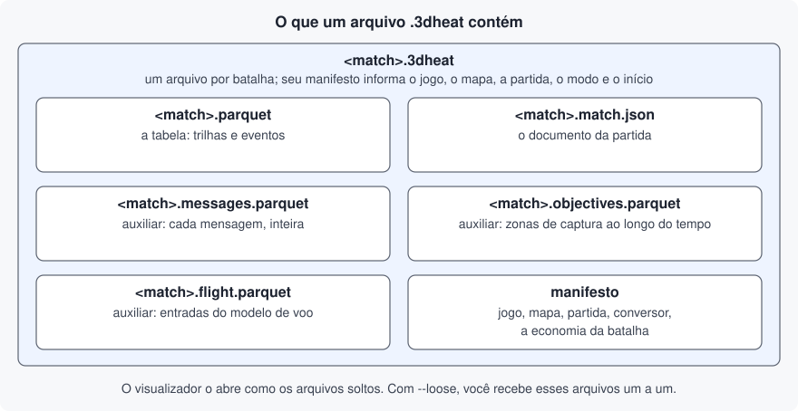
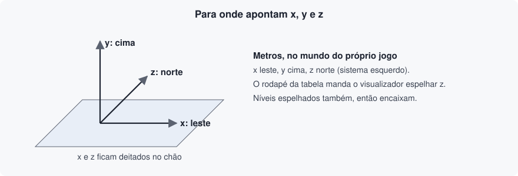

# Arquivos de saída {#output-files}

Por padrão, cada batalha é **um único arquivo**, `out/<map>/<match>.3dheat`: a
tabela, o documento da partida e os arquivos auxiliares, juntos, com um manifesto
que informa o jogo, o mapa, a partida, o modo de batalha, a hora de início e o
conversor (e a economia da batalha em `extensions["heat3d/economy"]`). O formato é
o do visualizador: [Um arquivo por partida (.3dheat)](https://holdi601.github.io/3DHeat/container.html).

Com `--loose`, os mesmos arquivos são gravados lado a lado:

| Arquivo | O que é | Página |
|---|---|---|
| `<match>.parquet` | uma linha por amostra ou evento | [A tabela](table.md) |
| `<match>.match.json` | tudo o mais que o replay informa | [O documento da partida](match-document.md) |
| `<match>.messages.parquet` | cada mensagem, valor de componente e pacote, inteiros | [Arquivos auxiliares](sidecars.md) |
| `<match>.objectives.parquet` | as zonas de captura ao longo do tempo | [Arquivos auxiliares](sidecars.md) |
| `<match>.flight.parquet` | cada entrada do modelo de voo de cada avião, inteira | [Arquivos auxiliares](sidecars.md) |

Se o empacotamento falhar, os arquivos soltos são mantidos e a linha avisa isso.

## Nomes {#names}

`<match>` é `<map>_<AB|RB|SB>_<mode>_<início, UTC>_<id da sessão>`, como na
figura: veja [Quais arquivos formam uma batalha](converting.md#which-files-are-one-battle).
`<map>` é o identificador do mapa no próprio jogo (`99_testmap` nas figuras).

## Coordenadas {#coordinates}

Metros, no mundo do próprio jogo: x para leste, y para cima, z para norte. O rodapé
da tabela diz ao visualizador para espelhar z, e os níveis de `heat3d-wt-level` são
gravados do mesmo jeito, então um replay e o seu nível se encaixam.

---

Parte do [3DHeat](https://github.com/Holdi601/3DHeat) ([documentação](https://holdi601.github.io/3DHeat/)). Código: [3DHeat-Ext-WarThunder](https://github.com/Holdi601/3DHeat-Ext-WarThunder).
