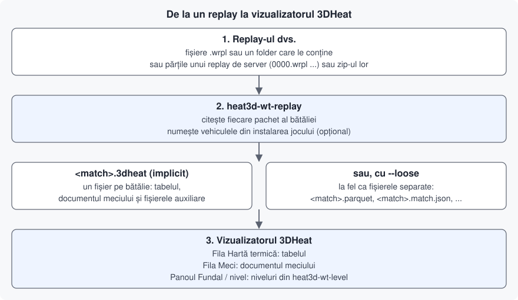

# Replay-uri War Thunder pentru 3DHeat {#dheat-war-thunder-replays}

**Ce este?** War Thunder poate înregistra o bătălie ca fișier de replay. Acest instrument
transformă înregistrarea într-un fișier pe care îl puteți urmări de sus, în
[vizualizatorul 3DHeat](https://holdi601.github.io/3DHeat/), cu fiecare avion, tanc
și navă, fiecare rachetă și bombă și fiecare lovitură acolo unde s-a întâmplat. O a doua
comandă transformă nivelurile din instalarea dumneavoastră de joc în niveluri 3D pe care să
arătați bătăliile.

**De ce l-ați folosi?** Pentru o analiză 3D a unei bătălii; pentru hărți termice ale
locurilor unde zburați, conduceți, luptați și muriți dumneavoastră și ceilalți, peste multe bătălii;
ca să vedeți unde au nimerit loviturile pe un vehicul; ca să vedeți ce a costat și ce a
câștigat o bătălie. Rezultatul este Parquet și JSON simplu, deci și alte instrumente
îl pot citi.

**Exemplu:** un replay `.wrpl` la intrare, un fișier `<match>.3dheat` la ieșire:



## Pornire rapidă {#quick-start}

Sunteți nou cu linia de comandă? Citiți mai întâi [Înainte de început](before-you-start.md).

```bash
git clone https://github.com/Holdi601/3DHeat-Ext-WarThunder.git
cd 3DHeat-Ext-WarThunder
pip install -e .                                  # instalează heat3d-wt-replay și heat3d-wt-level
heat3d-wt-replay "<War Thunder>/Replays" -o out
```

Ar trebui să vedeți câte o linie pentru fiecare bătălie: `ok out/<map>/<match>.3dheat`. Deschideți
acel fișier în vizualizatorul 3DHeat.

## Această documentație {#this-documentation}

| Pagina | Ce acoperă |
|---|---|
| [Înainte de început](before-you-start.md) | Python, un terminal și cum arată un rezultat reușit |
| [Instalare](installing.md) | instalare, nume din instalarea dumneavoastră, actualizări |
| [Convertirea replay-urilor](converting.md) | `heat3d-wt-replay` pas cu pas, fiecare opțiune, mesaje |
| [Fișierele de ieșire](output-files.md) | fișierul `.3dheat`, fișierele `--loose`, nume |
| [Tabelul](table.md) | fiecare coloană și eveniment |
| [Documentul meciului](match-document.md) | fiecare cheie din `<match>.match.json` |
| [Fișiere auxiliare și completitudine](sidecars.md) | ce se păstrează întreg pe lângă tabel, și numărătorile |
| [Niveluri](levels.md) | `heat3d-wt-level`: niveluri din instalarea dumneavoastră, ca `.glb` |
| [Cum citește un replay](how-it-reads.md) | ce se citește și cum a fost verificat |
| [Avioane](aircraft.md), [Unități terestre și cameră](ground.md), [Lovituri, tragere și incendii](hits.md) | detaliile din spatele coloanelor |
| [Economie](economy.md), [Obiective](objectives.md) | Silver Lions și puncte de cercetare; zone de capturare, aerodromuri |
| [Termeni și licență](terms.md) | termenii Gaijin, surse, teste, licență |
| [Referința comenzilor](../cli-reference.md), [Lista coloanelor](../columns.md) | generate din cod |

## Parte din 3DHeat {#part-of-3dheat}

Acest convertor este unul dintre instrumentele [3DHeat](https://github.com/Holdi601/3DHeat),
un vizualizator 3D de telemetrie și replay în timp real ([documentație](https://holdi601.github.io/3DHeat/)).
Vizualizatorul deschide fișierul `.3dheat`: tabelul în fila sa Hartă termică, documentul
meciului în fila sa Meci ([Un fișier pentru un meci](https://holdi601.github.io/3DHeat/container.html)).
Ce trebuie să păstreze orice convertor: [Convertoarele păstrează tot](https://holdi601.github.io/3DHeat/converters.html).

**De ce este un instrument separat.** Formatul `.wrpl` nu este documentat, iar
EULA Gaijin (3.2.2, 3.2.9) interzice inversarea jocului și extragerea de date care nu
sunt făcute să fie afișate; nu menționează replay-urile, pe care jocul însuși
le arată jucătorului. Ca o întrebare de licență să atingă doar acest convertor, el
trăiește în afara 3DHeat Watcher: Watcher îl rulează pe replay-urile noi când este
instalat, și funcționează și fără el.

| Instrument | Ce face | Sursă | Documentație |
|---|---|---|---|
| Vizualizatorul 3DHeat | arată datele în 3D: hărți termice, replay-uri, analiză de cursă | [3DHeat](https://github.com/Holdi601/3DHeat) | [site](https://holdi601.github.io/3DHeat/) |
| GameFiles | trasee și niveluri scoase din fișierele pe care le livrează jocurile | [3DHeat-GameFiles](https://github.com/Holdi601/3DHeat-GameFiles) | [site](https://holdi601.github.io/3DHeat-GameFiles/) |
| GameCapture | telemetria turelor, și niveluri reconstruite din video de joc | [3DHeat-GameCapture](https://github.com/Holdi601/3DHeat-GameCapture) | [site](https://holdi601.github.io/3DHeat-GameCapture/) |
| Unreal Exporter | un plugin pentru Unreal Editor care exportă un nivel | [3DHeat-UnrealExporter](https://github.com/Holdi601/3DHeat-UnrealExporter) | [site](https://holdi601.github.io/3DHeat-UnrealExporter/) |
| CS2 | demo-uri și hărți Counter-Strike 2 | [3DHeat-CS2](https://github.com/Holdi601/3DHeat-CS2) | [site](https://holdi601.github.io/3DHeat-CS2/) |
| Watcher | înregistrează ce publică jocurile cât jucați | [3DHeat-Watcher](https://github.com/Holdi601/3DHeat-Watcher) | [site](https://holdi601.github.io/3DHeat-Watcher/) |
| Replay-uri War Thunder | replay-uri `.wrpl` și niveluri War Thunder | [3DHeat-Ext-WarThunder](https://github.com/Holdi601/3DHeat-Ext-WarThunder) | [site](https://holdi601.github.io/3DHeat-Ext-WarThunder/) |
| Replay-uri World of Tanks | replay-uri `.wotreplay` | [3DHeat-Ext-WoT](https://github.com/Holdi601/3DHeat-Ext-WoT) | [site](https://holdi601.github.io/3DHeat-Ext-WoT/) |
| Replay-uri World of Warships | replay-uri `.wowsreplay` | [3DHeat-Ext-WoWs](https://github.com/Holdi601/3DHeat-Ext-WoWs) | [site](https://holdi601.github.io/3DHeat-Ext-WoWs/) |
| Demo-uri Squad | demo-uri de server Squad | [3DHeat-Ext-Squad](https://github.com/Holdi601/3DHeat-Ext-Squad) | [site](https://holdi601.github.io/3DHeat-Ext-Squad/) |
| Hărți DCS | hărțile DCS World ca niveluri 3D | [3DHeat-Ext-DCS](https://github.com/Holdi601/3DHeat-Ext-DCS) | [site](https://holdi601.github.io/3DHeat-Ext-DCS/) |
| Hărți IL-2 | hărțile IL-2 Great Battles ca niveluri 3D | [3DHeat-Ext-IL2](https://github.com/Holdi601/3DHeat-Ext-IL2) | [site](https://holdi601.github.io/3DHeat-Ext-IL2/) |

---

Parte din [3DHeat](https://github.com/Holdi601/3DHeat) ([documentație](https://holdi601.github.io/3DHeat/)). Sursă: [3DHeat-Ext-WarThunder](https://github.com/Holdi601/3DHeat-Ext-WarThunder).
