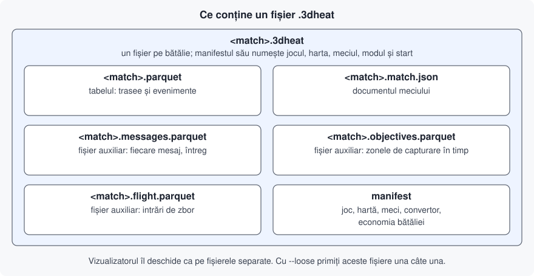
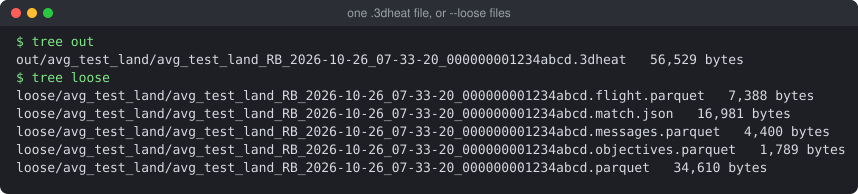
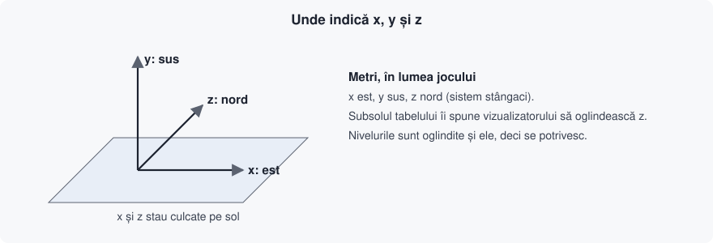

# Fișierele de ieșire {#output-files}

Implicit fiecare bătălie este **un singur fișier**, `out/<map>/<match>.3dheat`: tabelul, documentul
meciului și fișierele auxiliare împachetate împreună, cu un manifest care numește jocul, harta, meciul, modul
bătăliei, ora de start și convertorul (și economia bătăliei sub `extensions["heat3d/economy"]`). Formatul este cel al
vizualizatorului: [Un fișier pentru un meci (.3dheat)](https://holdi601.github.io/3DHeat/container.html).

Cu `--loose`, aceleași fișiere sunt scrise alăturat:

| Fișier | Ce este | Pagina |
|---|---|---|
| `<match>.parquet` | un rând pe eșantion sau eveniment | [Tabelul](table.md) |
| `<match>.match.json` | tot restul pe care îl spune replay-ul | [Documentul meciului](match-document.md) |
| `<match>.messages.parquet` | fiecare mesaj, valoare de componentă și pachet, întreg | [Fișiere auxiliare](sidecars.md) |
| `<match>.objectives.parquet` | zonele de capturare în timp | [Fișiere auxiliare](sidecars.md) |
| `<match>.flight.parquet` | fiecare intrare a modelului de zbor a fiecărui avion, întreagă | [Fișiere auxiliare](sidecars.md) |

Dacă împachetarea eșuează, fișierele separate sunt păstrate și linia o spune.

## Nume {#names}

`<match>` este `<map>_<AB|RB|SB>_<mode>_<start, UTC>_<session id>`, ca în
imagine: vedeți [Ce fișiere sunt o bătălie](converting.md#which-files-are-one-battle).
`<map>` este id-ul propriu al jocului pentru hartă (`99_testmap` în imagini).

## Coordonate {#coordinates}

Metri, în lumea proprie a jocului: x est, y sus, z nord. Subsolul tabelului
îi spune vizualizatorului să oglindească z, iar nivelurile din `heat3d-wt-level` sunt scrise
la fel, deci un replay și nivelul său se suprapun.

---

Parte din [3DHeat](https://github.com/Holdi601/3DHeat) ([documentație](https://holdi601.github.io/3DHeat/)). Sursă: [3DHeat-Ext-WarThunder](https://github.com/Holdi601/3DHeat-Ext-WarThunder).
