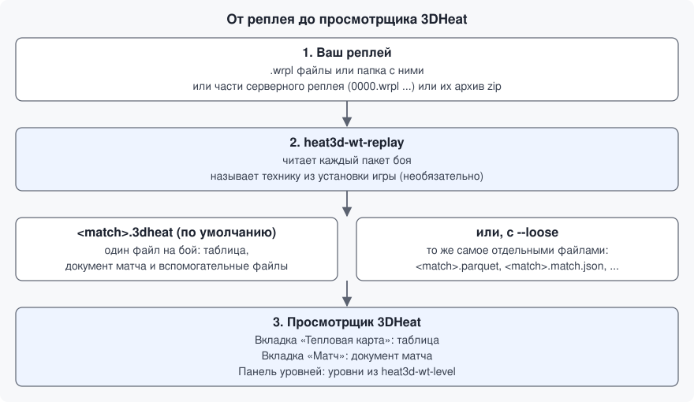

# 3DHeat: реплеи War Thunder {#dheat-war-thunder-replays}

**Что это?** War Thunder умеет записывать бой в файл реплея. Этот инструмент
превращает запись в файл, который можно посмотреть сверху в
[просмотрщике 3DHeat](https://holdi601.github.io/3DHeat/): каждый самолёт, танк
и корабль, каждая ракета и бомба и каждое попадание там, где оно произошло. Вторая
команда превращает уровни из вашей установки игры в трёхмерные уровни, на которых
показываются бои.

**Зачем это нужно?** Чтобы разобрать бой в 3D; чтобы строить тепловые карты того,
где вы и другие летаете, ездите, сражаетесь и погибаете в многих боях; чтобы видеть,
куда попали снаряды по технике; чтобы видеть, что бой стоил и что принёс. Результат
записан в простых форматах Parquet и JSON, поэтому его могут читать и другие
программы.

**Пример:** на входе один реплей `.wrpl`, на выходе один файл `<match>.3dheat`:



## Быстрый старт {#quick-start}

Впервые работаете с командной строкой? Сначала прочитайте [Перед началом](before-you-start.md).

```bash
git clone https://github.com/Holdi601/3DHeat-Ext-WarThunder.git
cd 3DHeat-Ext-WarThunder
pip install -e .                                  # installs heat3d-wt-replay and heat3d-wt-level
heat3d-wt-replay "<War Thunder>/Replays" -o out
```

На каждый бой вы увидите одну строку: `ok out/<map>/<match>.3dheat`. Откройте этот
файл в просмотрщике 3DHeat.

## Эта документация {#this-documentation}

| Страница | Что в ней |
|---|---|
| [Перед началом](before-you-start.md) | Python, терминал и как понять, что всё получилось |
| [Установка](installing.md) | установка, названия из вашей игры, обновления |
| [Преобразование реплеев](converting.md) | `heat3d-wt-replay` по шагам, каждый параметр, сообщения |
| [Файлы результата](output-files.md) | файл `.3dheat`, файлы `--loose`, имена |
| [Таблица](table.md) | каждый столбец и каждое событие |
| [Документ матча](match-document.md) | каждый ключ файла `<match>.match.json` |
| [Вспомогательные файлы и полнота](sidecars.md) | что сохраняется целиком помимо таблицы, и подсчёты |
| [Уровни](levels.md) | `heat3d-wt-level`: уровни из вашей установки в виде `.glb` |
| [Как читается реплей](how-it-reads.md) | что читается из реплея и как это проверено |
| [Самолёты](aircraft.md), [Наземная техника и камера](ground.md), [Попадания, стрельба и пожары](hits.md) | подробности за столбцами |
| [Экономика](economy.md), [Цели](objectives.md) | серебряные львы и очки исследований; зоны захвата, аэродромы |
| [Условия и лицензия](terms.md) | условия Gaijin, источники, тесты, лицензия |
| [Справка по командам](../cli-reference.md), [Список столбцов](../columns.md) | создано из кода |

## Часть 3DHeat {#part-of-3dheat}

Этот преобразователь — один из инструментов [3DHeat](https://github.com/Holdi601/3DHeat),
программы для трёхмерной телеметрии и просмотра реплеев в реальном времени
([документация](https://holdi601.github.io/3DHeat/)). Просмотрщик открывает файл
`.3dheat`: таблицу — на его вкладке «Тепловая карта», документ матча — на вкладке
«Матч» ([Один файл на матч](https://holdi601.github.io/3DHeat/container.html)).
Что обязан сохранять каждый преобразователь:
[Преобразователи сохраняют всё](https://holdi601.github.io/3DHeat/converters.html).

**Почему это отдельный инструмент.** Формат `.wrpl` не описан в открытом виде, а
Пользовательское соглашение Gaijin (3.2.2, 3.2.9) запрещает обратную разработку
игры и добычу данных, которые не предназначены для показа; о реплеях в нём ничего
не сказано, их сама игра показывает игроку. Чтобы вопрос лицензии касался только
этого преобразователя, он вынесен за пределы 3DHeat Watcher: Watcher запускает его
для новых реплеев, если он установлен, и работает и без него.

| Инструмент | Что делает | Исходный код | Документация |
|---|---|---|---|
| Просмотрщик 3DHeat | показывает данные в 3D: тепловые карты, реплеи, анализ гонок | [3DHeat](https://github.com/Holdi601/3DHeat) | [сайт](https://holdi601.github.io/3DHeat/) |
| GameFiles | трассы и уровни из файлов, которые поставляют игры | [3DHeat-GameFiles](https://github.com/Holdi601/3DHeat-GameFiles) | [сайт](https://holdi601.github.io/3DHeat-GameFiles/) |
| GameCapture | телеметрия кругов и уровни, восстановленные по видеозаписи игры | [3DHeat-GameCapture](https://github.com/Holdi601/3DHeat-GameCapture) | [сайт](https://holdi601.github.io/3DHeat-GameCapture/) |
| Unreal Exporter | плагин для редактора Unreal, который экспортирует уровень | [3DHeat-UnrealExporter](https://github.com/Holdi601/3DHeat-UnrealExporter) | [сайт](https://holdi601.github.io/3DHeat-UnrealExporter/) |
| CS2 | демки и карты Counter-Strike 2 | [3DHeat-CS2](https://github.com/Holdi601/3DHeat-CS2) | [сайт](https://holdi601.github.io/3DHeat-CS2/) |
| Watcher | записывает то, что игры публикуют во время вашей игры | [3DHeat-Watcher](https://github.com/Holdi601/3DHeat-Watcher) | [сайт](https://holdi601.github.io/3DHeat-Watcher/) |
| Реплеи War Thunder | реплеи `.wrpl` и уровни War Thunder | [3DHeat-Ext-WarThunder](https://github.com/Holdi601/3DHeat-Ext-WarThunder) | [сайт](https://holdi601.github.io/3DHeat-Ext-WarThunder/) |
| Реплеи World of Tanks | реплеи `.wotreplay` | [3DHeat-Ext-WoT](https://github.com/Holdi601/3DHeat-Ext-WoT) | [сайт](https://holdi601.github.io/3DHeat-Ext-WoT/) |
| Реплеи World of Warships | реплеи `.wowsreplay` | [3DHeat-Ext-WoWs](https://github.com/Holdi601/3DHeat-Ext-WoWs) | [сайт](https://holdi601.github.io/3DHeat-Ext-WoWs/) |
| Демки Squad | демки серверов Squad | [3DHeat-Ext-Squad](https://github.com/Holdi601/3DHeat-Ext-Squad) | [сайт](https://holdi601.github.io/3DHeat-Ext-Squad/) |
| Карты DCS | карты DCS World как трёхмерные уровни | [3DHeat-Ext-DCS](https://github.com/Holdi601/3DHeat-Ext-DCS) | [сайт](https://holdi601.github.io/3DHeat-Ext-DCS/) |
| Карты IL-2 | карты IL-2 Great Battles как трёхмерные уровни | [3DHeat-Ext-IL2](https://github.com/Holdi601/3DHeat-Ext-IL2) | [сайт](https://holdi601.github.io/3DHeat-Ext-IL2/) |

---

Часть [3DHeat](https://github.com/Holdi601/3DHeat) ([документация](https://holdi601.github.io/3DHeat/)). Исходный код: [3DHeat-Ext-WarThunder](https://github.com/Holdi601/3DHeat-Ext-WarThunder).
