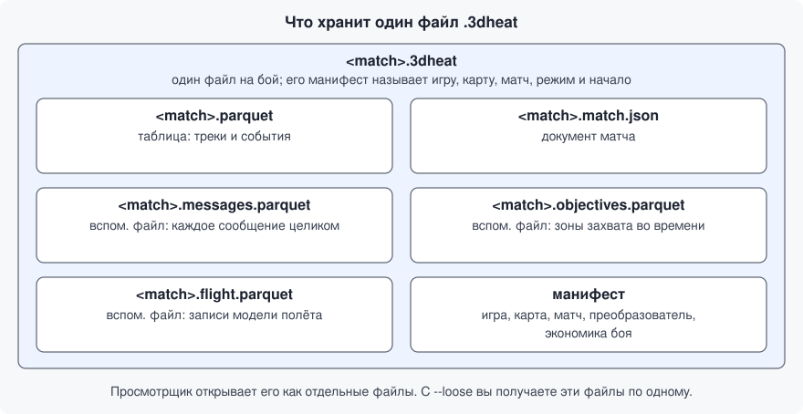
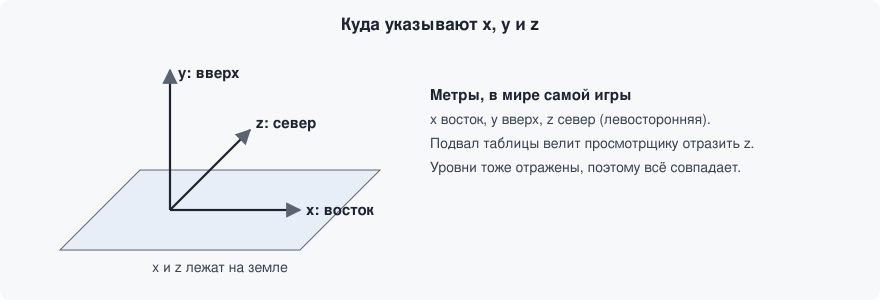

# Файлы результата {#output-files}

По умолчанию каждый бой — это **один файл**, `out/<map>/<match>.3dheat`: таблица,
документ матча и вспомогательные файлы, упакованные вместе, с манифестом, в котором
указаны игра, карта, матч, режим боя, время начала и преобразователь (а также
экономика боя в `extensions["heat3d/economy"]`). Формат задаёт просмотрщик:
[Один файл на матч (.3dheat)](https://holdi601.github.io/3DHeat/container.html).

С `--loose` те же файлы записываются рядом друг с другом, без упаковки:

| Файл | Что в нём | Страница |
|---|---|---|
| `<match>.parquet` | одна строка на выборку или событие | [Таблица](table.md) |
| `<match>.match.json` | всё остальное, что говорит реплей | [Документ матча](match-document.md) |
| `<match>.messages.parquet` | каждое сообщение, значение компонента и пакет, целиком | [Вспомогательные файлы](sidecars.md) |
| `<match>.objectives.parquet` | зоны захвата во времени | [Вспомогательные файлы](sidecars.md) |
| `<match>.flight.parquet` | каждая запись модели полёта каждого самолёта, целиком | [Вспомогательные файлы](sidecars.md) |

Если упаковать не удалось, отдельные файлы сохраняются, и строка вывода об этом
сообщает.

## Имена {#names}

`<match>` — это `<map>_<AB|RB|SB>_<mode>_<start, UTC>_<session id>`, как на картинке:
см. [Какие файлы относятся к одному бою](converting.md#which-files-are-one-battle).
`<map>` — это идентификатор карты в игре (`99_testmap` на картинках).

## Координаты {#coordinates}

Метры, в мире самой игры: x — восток, y — вверх, z — север. Футер таблицы подсказывает
просмотрщику отразить z, и уровни из `heat3d-wt-level` записаны так же, поэтому
реплей и его уровень совпадают друг с другом.

---

Часть [3DHeat](https://github.com/Holdi601/3DHeat) ([документация](https://holdi601.github.io/3DHeat/)). Исходный код: [3DHeat-Ext-WarThunder](https://github.com/Holdi601/3DHeat-Ext-WarThunder).
