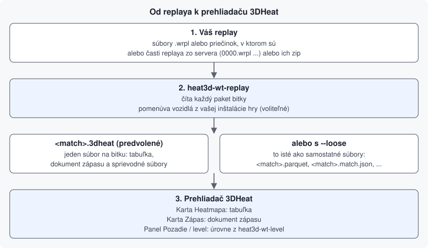

# 3DHeat replaye z War Thunder {#dheat-war-thunder-replays}

**Čo to je?** War Thunder dokáže bitku nahrať ako súbor replaye. Tento nástroj
z nahrávky vytvorí súbor, ktorý si môžete pozrieť zhora v
[3DHeat prehliadači](https://holdi601.github.io/3DHeat/): každé lietadlo, tank
a loď, každú raketu a bombu a každý zásah na mieste, kde sa stal. Druhý príkaz
premení levely z vašej nainštalovanej hry na 3D levely, na ktorých sa bitky
zobrazia.

**Prečo by som to používal?** Na 3D rozbor bitky; na heatmapy toho, kde vy aj
ostatní lietate, jazdíte, bojujete a umierate počas mnohých bitiek; na
zistenie, kam zasiahli zásahy vozidla; na prehľad o tom, čo bitka stála a
čo priniesla. Výstup je obyčajný Parquet a JSON, takže ho môžu čítať aj
iné nástroje.

**Príklad:** jeden `.wrpl` replay na vstupe, jeden súbor `<match>.3dheat` na výstupe:



## Rýchly štart {#quick-start}

Ste noví v príkazovom riadku? Najskôr si prečítajte [Než začnete](before-you-start.md).

```bash
git clone https://github.com/Holdi601/3DHeat-Ext-WarThunder.git
cd 3DHeat-Ext-WarThunder
pip install -e .                                  # nainštaluje heat3d-wt-replay a heat3d-wt-level
heat3d-wt-replay "<War Thunder>/Replays" -o out
```

Uvidíte jeden riadok na každú bitku: `ok out/<map>/<match>.3dheat`. Tento
súbor otvorte v 3DHeat prehliadači.

## Táto dokumentácia {#this-documentation}

| Stránka | Čo obsahuje |
|---|---|
| [Než začnete](before-you-start.md) | Python, terminál a to, ako vyzerá úspech |
| [Inštalácia](installing.md) | inštalácia, názvy z vašej inštalácie, aktualizácie |
| [Konverzia replayov](converting.md) | `heat3d-wt-replay` krok za krokom, každá možnosť, správy |
| [Výstupné súbory](output-files.md) | súbor `.3dheat`, súbory `--loose`, názvy |
| [Tabuľka](table.md) | každý stĺpec a každá udalosť |
| [Dokument zápasu](match-document.md) | každý kľúč v `<match>.match.json` |
| [Sprievodné súbory a úplnosť](sidecars.md) | čo sa uchováva celé popri tabuľke, a počty |
| [Levely](levels.md) | `heat3d-wt-level`: levely z vašej inštalácie ako `.glb` |
| [Ako sa replay číta](how-it-reads.md) | čo sa číta a ako to bolo overené |
| [Lietadlá](aircraft.md), [Pozemné jednotky a kamera](ground.md), [Zásahy, streľba a požiare](hits.md) | podrobnosti za stĺpcami |
| [Ekonomika](economy.md), [Ciele](objectives.md) | Silver Lions a výskumné body; zóny dobytia, letiská |
| [Podmienky a licencia](terms.md) | čo sa číta, zdroje, testy, licencia |
| [Referencia príkazov](../cli-reference.md), [Zoznam stĺpcov](../columns.md) | generované z kódu |

## Súčasť 3DHeat {#part-of-3dheat}

Tento konvertor je jedným z nástrojov [3DHeat](https://github.com/Holdi601/3DHeat),
prehliadača 3D telemetrie a replayov v reálnom čase ([dokumentácia](https://holdi601.github.io/3DHeat/)).
Prehliadač otvára súbor `.3dheat`: tabuľku na karte Heatmapa, dokument zápasu na
karte Zápas ([Jeden súbor na zápas](https://holdi601.github.io/3DHeat/container.html)).
Čo musí každý konvertor zachovať: [Konvertory zachovávajú všetko](https://holdi601.github.io/3DHeat/converters.html).

Každá čítačka hry je samostatný malý projekt s vlastným licenčným súborom, vydaniami a evidenciou problémov, takže ju možno inštalovať, aktualizovať, udržiavať - alebo na žiadosť držiteľa práv stiahnuť - samostatne, bez vplyvu na prehliadač a ostatné nástroje.
3DHeat Watcher spúšťa tento konvertor na nových replayoch, ak je nainštalovaný, a funguje aj bez neho.

| Nástroj | Čo robí | Zdroj | Dokumentácia |
|---|---|---|---|
| 3DHeat prehliadač | zobrazuje údaje v 3D: heatmapy, replaye, analýzu závodov | [3DHeat](https://github.com/Holdi601/3DHeat) | [stránka](https://holdi601.github.io/3DHeat/) |
| GameFiles | trate a levely zo súborov, ktoré hry obsahujú | [3DHeat-GameFiles](https://github.com/Holdi601/3DHeat-GameFiles) | [stránka](https://holdi601.github.io/3DHeat-GameFiles/) |
| GameCapture | telemetria kôl a levely zrekonštruované z videa hry | [3DHeat-GameCapture](https://github.com/Holdi601/3DHeat-GameCapture) | [stránka](https://holdi601.github.io/3DHeat-GameCapture/) |
| Unreal Exporter | plugin pre Unreal Editor, ktorý exportuje level | [3DHeat-UnrealExporter](https://github.com/Holdi601/3DHeat-UnrealExporter) | [stránka](https://holdi601.github.io/3DHeat-UnrealExporter/) |
| CS2 | dema a mapy Counter-Strike 2 | [3DHeat-CS2](https://github.com/Holdi601/3DHeat-CS2) | [stránka](https://holdi601.github.io/3DHeat-CS2/) |
| Watcher | zaznamenáva, čo hry zverejňujú počas hrania | [3DHeat-Watcher](https://github.com/Holdi601/3DHeat-Watcher) | [stránka](https://holdi601.github.io/3DHeat-Watcher/) |
| Replaye War Thunder | replaye `.wrpl` a levely War Thunder | [3DHeat-Ext-WarThunder](https://github.com/Holdi601/3DHeat-Ext-WarThunder) | [stránka](https://holdi601.github.io/3DHeat-Ext-WarThunder/) |
| Replaye World of Tanks | replaye `.wotreplay` | [3DHeat-Ext-WoT](https://github.com/Holdi601/3DHeat-Ext-WoT) | [stránka](https://holdi601.github.io/3DHeat-Ext-WoT/) |
| Replaye World of Warships | replaye `.wowsreplay` | [3DHeat-Ext-WoWs](https://github.com/Holdi601/3DHeat-Ext-WoWs) | [stránka](https://holdi601.github.io/3DHeat-Ext-WoWs/) |
| Dema Squad | dema zo serverov Squad | [3DHeat-Ext-Squad](https://github.com/Holdi601/3DHeat-Ext-Squad) | [stránka](https://holdi601.github.io/3DHeat-Ext-Squad/) |
| Mapy DCS | mapy DCS World ako 3D levely | [3DHeat-Ext-DCS](https://github.com/Holdi601/3DHeat-Ext-DCS) | [stránka](https://holdi601.github.io/3DHeat-Ext-DCS/) |
| Mapy IL-2 | mapy IL-2 Great Battles ako 3D levely | [3DHeat-Ext-IL2](https://github.com/Holdi601/3DHeat-Ext-IL2) | [stránka](https://holdi601.github.io/3DHeat-Ext-IL2/) |

---

Súčasť [3DHeat](https://github.com/Holdi601/3DHeat) ([dokumentácia](https://holdi601.github.io/3DHeat/)). Zdroj: [3DHeat-Ext-WarThunder](https://github.com/Holdi601/3DHeat-Ext-WarThunder).
