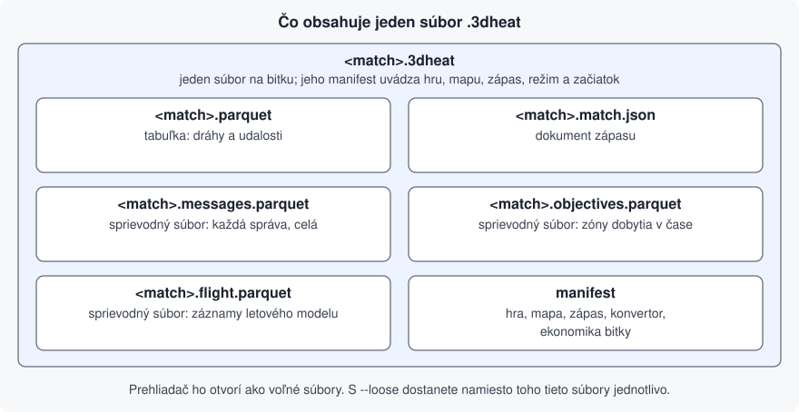
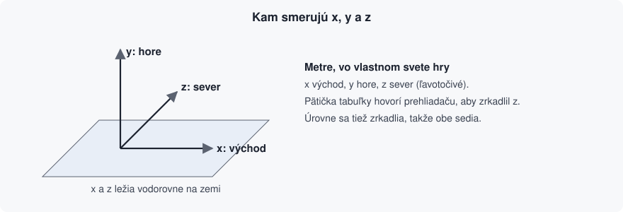

# Výstupné súbory {#output-files}

Predvolene je každá bitka **jeden súbor**, `out/<map>/<match>.3dheat`: tabuľka, dokument zápasu a
sprievodné súbory zabalené spolu, s manifestom, ktorý uvádza hru, mapu, zápas, režim bitky, čas začiatku
a konvertor (a ekonomiku bitky pod `extensions["heat3d/economy"]`). Formát je formát prehliadača:
[Jeden súbor na zápas (.3dheat)](https://holdi601.github.io/3DHeat/container.html).

S `--loose` sa rovnaké súbory zapíšu vedľa seba:

| Súbor | Čo | Stránka |
|---|---|---|
| `<match>.parquet` | jeden riadok na vzorku alebo udalosť | [Tabuľka](table.md) |
| `<match>.match.json` | všetko ostatné, čo replay hovorí | [Dokument zápasu](match-document.md) |
| `<match>.messages.parquet` | každá správa, hodnota komponentu a paket, celé | [Sprievodné súbory](sidecars.md) |
| `<match>.objectives.parquet` | zóny dobytia v čase | [Sprievodné súbory](sidecars.md) |
| `<match>.flight.parquet` | každý záznam modelu letu každého lietadla, celé | [Sprievodné súbory](sidecars.md) |

Ak zabalenie zlyhá, samostatné súbory ostanú a riadok to povie.

## Názvy {#names}

`<match>` je `<map>_<AB|RB|SB>_<mode>_<start, UTC>_<session id>`, ako na obrázku: pozri
[Ktoré súbory sú jedna bitka](converting.md#which-files-are-one-battle).
`<map>` je vlastné herné id mapy (`99_testmap` na obrázkoch).

## Súradnice {#coordinates}

Metre vo vlastnom svete hry: x na východ, y nahor, z na sever. Päta tabuľky hovorí prehliadaču, aby zrkadlil z,
a levely z `heat3d-wt-level` sa zapisujú rovnako, takže replay a jeho level ležia jeden na druhom.

---

Súčasť [3DHeat](https://github.com/Holdi601/3DHeat) ([dokumentácia](https://holdi601.github.io/3DHeat/)). Zdroj: [3DHeat-Ext-WarThunder](https://github.com/Holdi601/3DHeat-Ext-WarThunder).
