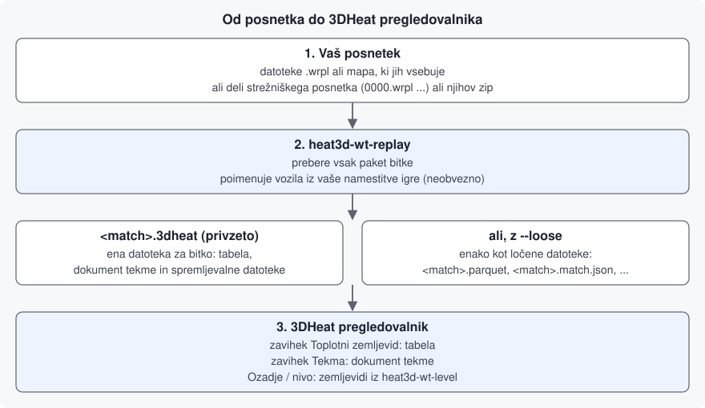

# 3DHeat posnetki iz War Thunder {#dheat-war-thunder-replays}

**Kaj je to?** War Thunder lahko bitko shrani kot datoteko s posnetkom. To orodje
pretvori posnetek v datoteko, ki si jo lahko ogledate od zgoraj v
[3DHeat pregledovalniku](https://holdi601.github.io/3DHeat/), z vsakim letalom, tankom
in ladjo, z vsako raketo in bombo ter z vsakim zadetkom na mestu, kjer se je zgodil.
Drugi ukaz pretvori zemljevide iz vaše lastne namestitve igre v 3D zemljevide, na
katerih se prikažejo bitke.

**Zakaj bi to uporabljal?** Za 3D pregled bitke; za toplotne zemljevide, kjer ste vi
in drugi leteli, vozili, borili in umirali v mnogih bitkah; za ogled, kje so zadetki
zadeli vozilo; za ogled, koliko je bitka stala in koliko prinesla. Izhod je navaden
Parquet in JSON, zato ga lahko berejo tudi druga orodja.

**Primer:** en `.wrpl` posnetek na vhodu, ena datoteka `<match>.3dheat` na izhodu:



## Hitri začetek {#quick-start}

Ste novi v ukazni vrstici? Najprej preberite [Preden začnete](before-you-start.md).

```bash
git clone https://github.com/Holdi601/3DHeat-Ext-WarThunder.git
cd 3DHeat-Ext-WarThunder
pip install -e .                                  # namesti heat3d-wt-replay in heat3d-wt-level
heat3d-wt-replay "<War Thunder>/Replays" -o out
```

Videli boste eno vrstico za vsako bitko: `ok out/<map>/<match>.3dheat`. Odprite to
datoteko v 3DHeat pregledovalniku.

## Ta dokumentacija {#this-documentation}

| Stran | Kaj obravnava |
|---|---|
| [Preden začnete](before-you-start.md) | Python, ukazna vrstica in kako izgleda uspeh |
| [Namestitev](installing.md) | namestitev, imena iz vaše namestitve, posodobitve |
| [Pretvorba posnetkov](converting.md) | `heat3d-wt-replay` korak za korakom, vsaka možnost, sporočila |
| [Izhodne datoteke](output-files.md) | datoteka `.3dheat`, datoteke `--loose`, imena |
| [Tabela](table.md) | vsak stolpec in dogodek |
| [Dokument tekme](match-document.md) | vsak ključ v `<match>.match.json` |
| [Spremljevalne datoteke in popolnost](sidecars.md) | kaj je poleg tabele ohranjeno celo, in števila |
| [Zemljevidi](levels.md) | `heat3d-wt-level`: zemljevidi iz vaše namestitve kot `.glb` |
| [Kako bere posnetek](how-it-reads.md) | kaj se prebere in kako je bilo preverjeno |
| [Letala](aircraft.md), [Kopenske enote in kamera](ground.md), [Zadetki, streljanje in požari](hits.md) | podrobnosti za stolpce |
| [Gospodarstvo](economy.md), [Cilji](objectives.md) | Silver Lions in točke raziskav; območja zajema, letališča |
| [Pogoji in licenca](terms.md) | Gaijinovi pogoji, viri, testi, licenca |
| [Referenca ukazov](../cli-reference.md), [Seznam stolpcev](../columns.md) | ustvarjeno iz kode |

## Del 3DHeat {#part-of-3dheat}

Ta pretvornik je eno od orodij [3DHeat](https://github.com/Holdi601/3DHeat),
pregledovalnika telemetrije in posnetkov v realnem času v 3D ([dokumentacija](https://holdi601.github.io/3DHeat/)).
Pregledovalnik odpre datoteko `.3dheat`: tabelo na zavihku Toplotni zemljevid, dokument
tekme na zavihku Tekma ([Ena datoteka za tekmo](https://holdi601.github.io/3DHeat/container.html)).
Kaj mora vsak pretvornik ohraniti: [Pretvorniki ohranijo vse](https://holdi601.github.io/3DHeat/converters.html).

**Zakaj je to ločeno orodje.** Format `.wrpl` ni dokumentiran, Gaijinova licenčna
pogodba (3.2.2, 3.2.9) pa prepoveduje reverzno inženiringo igre in rudarjenje podatkov,
ki niso namenjeni prikazu; ne omenja posnetkov, ki jih igra sama prikaže igralcu. Da se
vprašanje licence dotika samo tega pretvornika, je zunaj 3DHeat Watcherja: Watcher ga
zažene na novih posnetkih, če je nameščen, in deluje tudi brez njega.

| Orodje | Kaj počne | Vir | Dokumentacija |
|---|---|---|---|
| 3DHeat pregledovalnik | prikaz podatkov v 3D: toplotni zemljevidi, posnetki, analiza dirk | [3DHeat](https://github.com/Holdi601/3DHeat) | [spletna stran](https://holdi601.github.io/3DHeat/) |
| GameFiles | poti in zemljevidi iz datotek, ki jih igre prinašajo | [3DHeat-GameFiles](https://github.com/Holdi601/3DHeat-GameFiles) | [spletna stran](https://holdi601.github.io/3DHeat-GameFiles/) |
| GameCapture | telemetrija krogov in zemljevidi, obnovljeni iz posnetkov igre | [3DHeat-GameCapture](https://github.com/Holdi601/3DHeat-GameCapture) | [spletna stran](https://holdi601.github.io/3DHeat-GameCapture/) |
| Unreal Exporter | vtičnik za Unreal Editor, ki izvozi zemljevid | [3DHeat-UnrealExporter](https://github.com/Holdi601/3DHeat-UnrealExporter) | [spletna stran](https://holdi601.github.io/3DHeat-UnrealExporter/) |
| CS2 | demonstracije in zemljevidi za Counter-Strike 2 | [3DHeat-CS2](https://github.com/Holdi601/3DHeat-CS2) | [spletna stran](https://holdi601.github.io/3DHeat-CS2/) |
| Watcher | beleži, kar igre objavijo med igranjem | [3DHeat-Watcher](https://github.com/Holdi601/3DHeat-Watcher) | [spletna stran](https://holdi601.github.io/3DHeat-Watcher/) |
| Posnetki War Thunder | posnetki `.wrpl` in zemljevidi War Thunder | [3DHeat-Ext-WarThunder](https://github.com/Holdi601/3DHeat-Ext-WarThunder) | [spletna stran](https://holdi601.github.io/3DHeat-Ext-WarThunder/) |
| Posnetki World of Tanks | posnetki `.wotreplay` | [3DHeat-Ext-WoT](https://github.com/Holdi601/3DHeat-Ext-WoT) | [spletna stran](https://holdi601.github.io/3DHeat-Ext-WoT/) |
| Posnetki World of Warships | posnetki `.wowsreplay` | [3DHeat-Ext-WoWs](https://github.com/Holdi601/3DHeat-Ext-WoWs) | [spletna stran](https://holdi601.github.io/3DHeat-Ext-WoWs/) |
| Demonstracije Squad | demonstracije strežnika Squad | [3DHeat-Ext-Squad](https://github.com/Holdi601/3DHeat-Ext-Squad) | [spletna stran](https://holdi601.github.io/3DHeat-Ext-Squad/) |
| Zemljevidi DCS | zemljevidi DCS World kot 3D zemljevidi | [3DHeat-Ext-DCS](https://github.com/Holdi601/3DHeat-Ext-DCS) | [spletna stran](https://holdi601.github.io/3DHeat-Ext-DCS/) |
| Zemljevidi IL-2 | zemljevidi IL-2 Great Battles kot 3D zemljevidi | [3DHeat-Ext-IL2](https://github.com/Holdi601/3DHeat-Ext-IL2) | [spletna stran](https://holdi601.github.io/3DHeat-Ext-IL2/) |

---

Del [3DHeat](https://github.com/Holdi601/3DHeat) ([dokumentacija](https://holdi601.github.io/3DHeat/)). Vir: [3DHeat-Ext-WarThunder](https://github.com/Holdi601/3DHeat-Ext-WarThunder).
