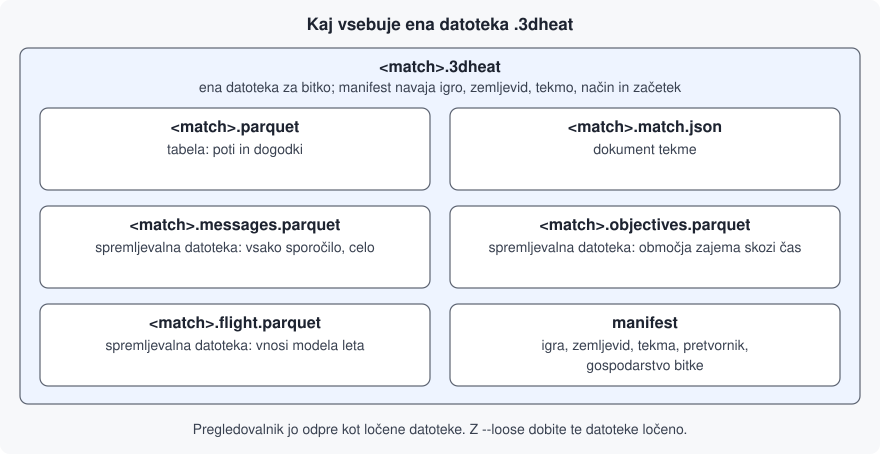
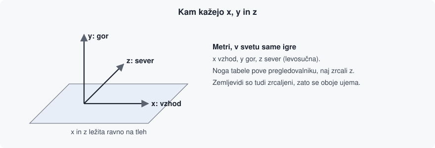

# Izhodne datoteke {#output-files}

Privzeto je vsaka bitka **ena datoteka**, `out/<map>/<match>.3dheat`: tabela, dokument
tekme in spremljevalne datoteke, stisnjene skupaj, z manifestom, ki navaja igro, zemljevid,
tekmo, način bitke, čas začetka in pretvornik (ter gospodarstvo bitke pod
`extensions["heat3d/economy"]`). Format je pregledovalnikov:
[Ena datoteka za tekmo (.3dheat)](https://holdi601.github.io/3DHeat/container.html).

Z `--loose` se enake datoteke zapišejo ena poleg druge:

| Datoteka | Vsebina | Stran |
|---|---|---|
| `<match>.parquet` | ena vrstica na vzorec ali dogodek | [Tabela](table.md) |
| `<match>.match.json` | vse ostalo, kar posnetek pove | [Dokument tekme](match-document.md) |
| `<match>.messages.parquet` | vsako sporočilo, vrednost komponente in paket, celo | [Spremljevalne datoteke](sidecars.md) |
| `<match>.objectives.parquet` | območja zajema skozi čas | [Spremljevalne datoteke](sidecars.md) |
| `<match>.flight.parquet` | vsak vnos modela leta vsakega letala, celo | [Spremljevalne datoteke](sidecars.md) |

Če stiskanje spodleti, ostanejo ločene datoteke, vrstica pa to pove.

## Imena {#names}

`<match>` je `<map>_<AB|RB|SB>_<mode>_<start, UTC>_<session id>`, kot na sliki: glejte
[Katere datoteke so ena bitka](converting.md#katere-datoteke-so-ena-bitka).
`<map>` je igrin lastni identifikator zemljevida (`99_testmap` na slikah).

## Koordinate {#coordinates}

Metri, v svetu same igre: x vzhod, y gor, z sever. Noga tabele pove pregledovalniku, naj
zrcali z, in zemljevidi iz `heat3d-wt-level` so zapisani na enak način, zato posnetek in
njegov zemljevid ležita drug na drugem.

---

Del [3DHeat](https://github.com/Holdi601/3DHeat) ([dokumentacija](https://holdi601.github.io/3DHeat/)). Vir: [3DHeat-Ext-WarThunder](https://github.com/Holdi601/3DHeat-Ext-WarThunder).
