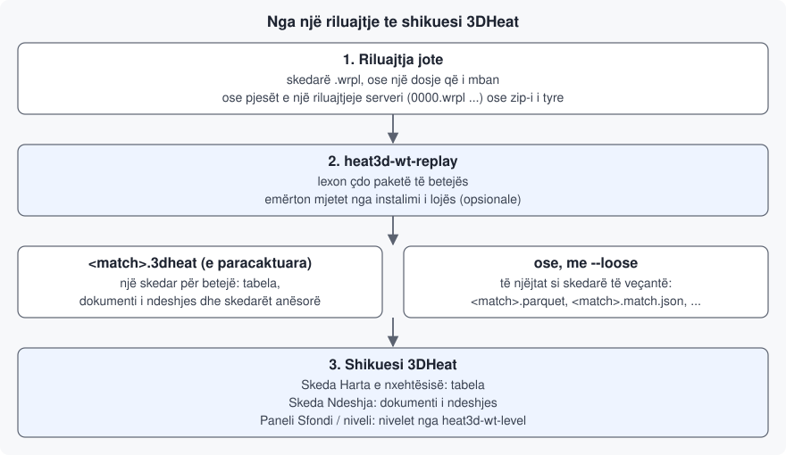

# Riluajtjet e War Thunder për 3DHeat {#dheat-war-thunder-replays}

**Çfarë është?** War Thunder mund ta regjistrojë një betejë si skedar riluajtjeje. Ky mjet e kthen regjistrimin në një skedar që mund ta shikosh nga lart në
[shikuesin 3DHeat](https://holdi601.github.io/3DHeat/), me çdo aeroplan, tank
dhe anije, çdo raketë dhe bombë, dhe çdo goditje aty ku ndodhi. Një komandë e dytë
i kthen nivelet e instalimit tënd të lojës në nivele 3D, ku mund t'i shfaqësh
betejat.

**Pse do ta përdorja?** Për një analizë të betejës në 3D; për harta nxehtësie
të vendeve ku ti dhe të tjerët fluturoni, voziteni, luftoni dhe vdisni gjatë shumë betejave; për të parë
ku kanë rënë goditjet mbi një mjet; për të parë sa kushtoi dhe sa fitoi një betejë. Rezultati
është Parquet dhe JSON i thjeshtë, kështu që mjete të tjera mund ta lexojnë edhe ato.

**Shembull:** një riluajtje `.wrpl` hyn, një skedar `<match>.3dheat` del:



## Fillimi i shpejtë {#quick-start}

Je i ri me rreshtin e komandave? Lexo së pari [Para se të fillosh](before-you-start.md).

```bash
git clone https://github.com/Holdi601/3DHeat-Ext-WarThunder.git
cd 3DHeat-Ext-WarThunder
pip install -e .                                  # installs heat3d-wt-replay and heat3d-wt-level
heat3d-wt-replay "<War Thunder>/Replays" -o out
```

Duhet të shohësh një rresht për çdo betejë: `ok out/<map>/<match>.3dheat`. Hape atë
skedar në shikuesin 3DHeat.

## Ky dokumentacion {#this-documentation}

| Faqja | Çfarë përfshin |
|---|---|
| [Para se të fillosh](before-you-start.md) | Python, një terminal dhe si duket suksesi |
| [Instalimi](installing.md) | instalimi, emrat nga instalimi yt, përditësimet |
| [Konvertimi i riluajtjeve](converting.md) | `heat3d-wt-replay` hap pas hapi, çdo opsion, mesazhet |
| [Skedarët e daljes](output-files.md) | skedari `.3dheat`, skedarët `--loose`, emrat |
| [Tabela](table.md) | çdo kolonë dhe ngjarje |
| [Dokumenti i ndeshjes](match-document.md) | çdo çelës i `<match>.match.json` |
| [Skedarët anësorë dhe plotësia](sidecars.md) | çfarë ruhet i plotë përveç tabelës, dhe numrat |
| [Nivelet](levels.md) | `heat3d-wt-level`: nivelet nga instalimi yt si `.glb` |
| [Si e lexon një riluajtje](how-it-reads.md) | çfarë lexohet dhe si u kontrollua |
| [Aeroplanët](aircraft.md), [Njësitë tokësore dhe kamera](ground.md), [Goditjet, të shtënat dhe zjarret](hits.md) | detajet pas kolonave |
| [Ekonomia](economy.md), [Objektivat](objectives.md) | Silver Lions dhe pikët e kërkimit; zonat e kapjes, fushat ajrore |
| [Kushtet dhe licenca](terms.md) | kushtet e Gaijin, burimet, testet, licenca |
| [Referenca e komandave](../cli-reference.md), [Lista e kolonave](../columns.md) | e gjeneruar nga kodi |

## Pjesë e 3DHeat {#part-of-3dheat}

Ky konvertues është një nga mjetet e [3DHeat](https://github.com/Holdi601/3DHeat),
një shikues telemetrie dhe riluajtjesh 3D në kohë reale ([dokumentacioni](https://holdi601.github.io/3DHeat/)).
Shikuesi e hap skedarin `.3dheat`: tabelën në skedën e tij Harta e nxehtësisë, dokumentin e ndeshjes
në skedën e tij Ndeshja ([Një skedar për ndeshje](https://holdi601.github.io/3DHeat/container.html)).
Çfarë duhet të ruajë çdo konvertues: [Konvertuesit ruajnë gjithçka](https://holdi601.github.io/3DHeat/converters.html).

**Pse është mjet i veçantë.** Formati `.wrpl` nuk është i dokumentuar, dhe
EULA e Gaijin (3.2.2, 3.2.9) ndalon inxhinierinë e kundërt të lojës dhe nxjerrjen e
të dhënave që nuk janë menduar të shfaqen; ajo nuk i përmend riluajtjet, të cilat loja vetë
ia tregon lojtarit. Që një pyetje licence të prekë vetëm këtë konvertues, ai
qëndron jashtë 3DHeat Watcher: Watcher e nis mbi riluajtjet e reja kur
është i instaluar, dhe funksionon edhe pa të.

| Mjeti | Çfarë bën | Burimi | Dokumentacioni |
|---|---|---|---|
| Shikuesi 3DHeat | i tregon të dhënat në 3D: harta nxehtësie, riluajtje, analizë gare | [3DHeat](https://github.com/Holdi601/3DHeat) | [faqja](https://holdi601.github.io/3DHeat/) |
| GameFiles | kurse dhe nivele nga skedarët që dërgojnë lojërat | [3DHeat-GameFiles](https://github.com/Holdi601/3DHeat-GameFiles) | [faqja](https://holdi601.github.io/3DHeat-GameFiles/) |
| GameCapture | telemetri xhiroje dhe nivele të rindërtuara nga video e lojës | [3DHeat-GameCapture](https://github.com/Holdi601/3DHeat-GameCapture) | [faqja](https://holdi601.github.io/3DHeat-GameCapture/) |
| Unreal Exporter | një shtojcë e Unreal Editor që eksporton një nivel | [3DHeat-UnrealExporter](https://github.com/Holdi601/3DHeat-UnrealExporter) | [faqja](https://holdi601.github.io/3DHeat-UnrealExporter/) |
| CS2 | demot dhe hartat e Counter-Strike 2 | [3DHeat-CS2](https://github.com/Holdi601/3DHeat-CS2) | [faqja](https://holdi601.github.io/3DHeat-CS2/) |
| Watcher | regjistron çfarë publikojnë lojërat ndërsa luan | [3DHeat-Watcher](https://github.com/Holdi601/3DHeat-Watcher) | [faqja](https://holdi601.github.io/3DHeat-Watcher/) |
| Riluajtjet e War Thunder | riluajtjet `.wrpl` dhe nivelet e War Thunder | [3DHeat-Ext-WarThunder](https://github.com/Holdi601/3DHeat-Ext-WarThunder) | [faqja](https://holdi601.github.io/3DHeat-Ext-WarThunder/) |
| Riluajtjet e World of Tanks | riluajtjet `.wotreplay` | [3DHeat-Ext-WoT](https://github.com/Holdi601/3DHeat-Ext-WoT) | [faqja](https://holdi601.github.io/3DHeat-Ext-WoT/) |
| Riluajtjet e World of Warships | riluajtjet `.wowsreplay` | [3DHeat-Ext-WoWs](https://github.com/Holdi601/3DHeat-Ext-WoWs) | [faqja](https://holdi601.github.io/3DHeat-Ext-WoWs/) |
| Demot e Squad | demot e serverit të Squad | [3DHeat-Ext-Squad](https://github.com/Holdi601/3DHeat-Ext-Squad) | [faqja](https://holdi601.github.io/3DHeat-Ext-Squad/) |
| Hartat e DCS | hartat e DCS World si nivele 3D | [3DHeat-Ext-DCS](https://github.com/Holdi601/3DHeat-Ext-DCS) | [faqja](https://holdi601.github.io/3DHeat-Ext-DCS/) |
| Hartat e IL-2 | hartat e IL-2 Great Battles si nivele 3D | [3DHeat-Ext-IL2](https://github.com/Holdi601/3DHeat-Ext-IL2) | [faqja](https://holdi601.github.io/3DHeat-Ext-IL2/) |

---

Pjesë e [3DHeat](https://github.com/Holdi601/3DHeat) ([dokumentacioni](https://holdi601.github.io/3DHeat/)). Burimi: [3DHeat-Ext-WarThunder](https://github.com/Holdi601/3DHeat-Ext-WarThunder).
