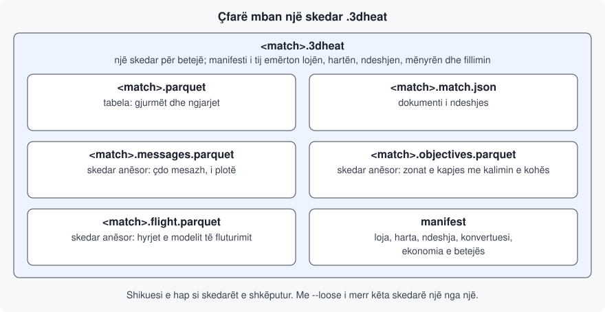
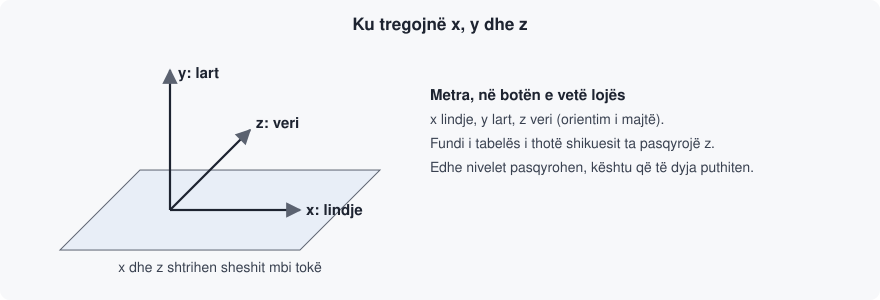

# Skedarët e daljes {#output-files}

Si parazgjedhje çdo betejë është **një skedar**, `out/<map>/<match>.3dheat`: tabela,
dokumenti i ndeshjes dhe skedarët anësorë të paketuar bashkë, me një manifest
që emërton lojën, hartën, ndeshjen, mënyrën e betejës, kohën e fillimit dhe konvertuesin (dhe
ekonominë e betejës te `extensions["heat3d/economy"]`). Formati është i shikuesit:
[Një skedar për ndeshje (.3dheat)](https://holdi601.github.io/3DHeat/container.html).

Me `--loose` të njëjtët skedarë shkruhen krah për krah, në vend të tij:

| Skedari | Çfarë | Faqja |
|---|---|---|
| `<match>.parquet` | një rresht për çdo mostër ose ngjarje | [Tabela](table.md) |
| `<match>.match.json` | gjithçka tjetër që thotë riluajtja | [Dokumenti i ndeshjes](match-document.md) |
| `<match>.messages.parquet` | çdo mesazh, vlerë komponenti dhe paketë, e plotë | [Skedarët anësorë](sidecars.md) |
| `<match>.objectives.parquet` | zonat e kapjes me kalimin e kohës | [Skedarët anësorë](sidecars.md) |
| `<match>.flight.parquet` | çdo hyrje e modelit të fluturimit për çdo aeroplan, e plotë | [Skedarët anësorë](sidecars.md) |

Nëse paketimi dështon, skedarët e shkëputur ruhen dhe rreshti e thotë këtë.

## Emrat {#names}

`<match>` është `<map>_<AB|RB|SB>_<mode>_<start, UTC>_<session id>`, si në
pamje: shih [Cilët skedarë janë një betejë](converting.md#which-files-are-one-battle).
`<map>` është ID e vetë lojës për hartën (`99_testmap` në pamjet).

## Koordinatat {#coordinates}

Metra, në botën e vetë lojës: x lindje, y lart, z veri. Fundi i tabelës
i thotë shikuesit ta pasqyrojë z, dhe nivelet nga `heat3d-wt-level` shkruhen
në të njëjtën mënyrë, kështu që një riluajtje dhe niveli i saj puthiten.

---

Pjesë e [3DHeat](https://github.com/Holdi601/3DHeat) ([dokumentacioni](https://holdi601.github.io/3DHeat/)). Burimi: [3DHeat-Ext-WarThunder](https://github.com/Holdi601/3DHeat-Ext-WarThunder).
