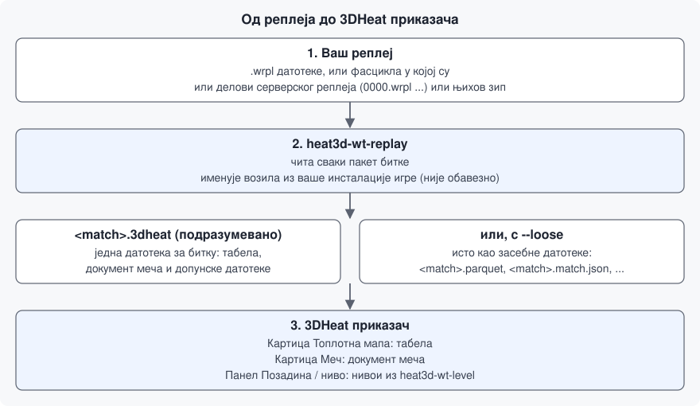

# 3DHeat реплеји War Thunder-а {#dheat-war-thunder-replays}

**Шта је то?** War Thunder може да сними битку као датотеку реплеја. Ова алатка
претвара снимак у датотеку коју можете гледати одозго у
[3DHeat приказачу](https://holdi601.github.io/3DHeat/), са сваким авионом, тенком
и бродом, сваком ракетом и бомбом, и сваким погоцем тамо где се десио. Друга
команда претвара нивое ваше сопствене инсталације игре у 3D нивое на којима се
битке приказују.

**Зашто бисте га користили?** За преглед битке у 3D; за топлотне мапе где сте
ви и други летели, возили, борили се и гинули кроз многе битке; да видите где
су погоци погодили возило; да видите колико је битка коштала и донела. Излаз је
обичан Parquet и JSON, па га могу читати и друге алатке.

**Пример:** један `.wrpl` реплеј на улазу, једна `<match>.3dheat` датотека на
излазу:



## Брзи почетак {#quick-start}

Први пут у командној линији? Прво прочитајте [Пре почетка](before-you-start.md).

```bash
git clone https://github.com/Holdi601/3DHeat-Ext-WarThunder.git
cd 3DHeat-Ext-WarThunder
pip install -e .                                  # инсталира heat3d-wt-replay и heat3d-wt-level
heat3d-wt-replay "<War Thunder>/Replays" -o out
```

Требало би да видите по један ред за сваку битку: `ok out/<map>/<match>.3dheat`.
Отворите ту датотеку у 3DHeat приказачу.

## Ова документација {#this-documentation}

| Страница | Шта обухвата |
|---|---|
| [Пре почетка](before-you-start.md) | Python, терминал и како изгледа успех |
| [Инсталација](installing.md) | инсталација, називи из ваше инсталације, ажурирања |
| [Претварање реплеја](converting.md) | `heat3d-wt-replay` корак по корак, свака опција, поруке |
| [Излазне датотеке](output-files.md) | `.3dheat` датотека, `--loose` датотеке, називи |
| [Табела](table.md) | свака колона и догађај |
| [Документ меча](match-document.md) | сваки кључ у `<match>.match.json` |
| [Пратеће датотеке и потпуност](sidecars.md) | што се чува цело поред табеле, и бројање |
| [Нивои](levels.md) | `heat3d-wt-level`: нивои из ваше инсталације као `.glb` |
| [Како чита реплеј](how-it-reads.md) | шта се чита, и како је проверено |
| [Авиони](aircraft.md), [Копнене јединице и камера](ground.md), [Погоци, паљба и пожари](hits.md) | појединости иза колона |
| [Економија](economy.md), [Циљеви](objectives.md) | сребрни лавови и истраживачки поени; зоне заузимања, аеродроми |
| [Услови и лиценца](terms.md) | Gaijin-ови услови, извори, тестови, лиценца |
| [Референца команди](../cli-reference.md), [Списак колона](../columns.md) | генерисано из кода |

## Део 3DHeat-а {#part-of-3dheat}

Овај конвертор је једна од алатки [3DHeat](https://github.com/Holdi601/3DHeat),
приказача 3D телеметрије и реплеја у реалном времену
([документација](https://holdi601.github.io/3DHeat/)). Приказач отвара
`.3dheat` датотеку: табелу на картици Топлотна мапа, документ меча на картици
Меч ([Једна датотека по мечу](https://holdi601.github.io/3DHeat/container.html)).
Шта сваки конвертор мора да задржи: [Конвертори задржавају све](https://holdi601.github.io/3DHeat/converters.html).

**Зашто је то посебна алатка.** Формат `.wrpl` није документован, а Gaijin-ов
EULA (3.2.2, 3.2.9) забрањује обрнуто инжењерство игре и прикупљање података који
нису намењени приказу; не помиње реплеје, које сама игра показује играчу. Да би
правно питање дотицало само овај конвертор, он живи ван 3DHeat Watcher-а:
Watcher га покреће над новим реплејима кад је инсталиран, а ради и без њега.

| Алатка | Шта ради | Извор | Документација |
|---|---|---|---|
| 3DHeat приказач | приказује податке у 3D: топлотне мапе, реплеје, анализу трке | [3DHeat](https://github.com/Holdi601/3DHeat) | [сајт](https://holdi601.github.io/3DHeat/) |
| GameFiles | стазе и нивои из датотека које игре испоручују | [3DHeat-GameFiles](https://github.com/Holdi601/3DHeat-GameFiles) | [сајт](https://holdi601.github.io/3DHeat-GameFiles/) |
| GameCapture | телеметрија кола и нивои обновљени из снимака игре | [3DHeat-GameCapture](https://github.com/Holdi601/3DHeat-GameCapture) | [сајт](https://holdi601.github.io/3DHeat-GameCapture/) |
| Unreal Exporter | додатак за Unreal Editor који извози ниво | [3DHeat-UnrealExporter](https://github.com/Holdi601/3DHeat-UnrealExporter) | [сајт](https://holdi601.github.io/3DHeat-UnrealExporter/) |
| CS2 | Counter-Strike 2 демои и мапе | [3DHeat-CS2](https://github.com/Holdi601/3DHeat-CS2) | [сајт](https://holdi601.github.io/3DHeat-CS2/) |
| Watcher | бележи оно што игре објављују док играте | [3DHeat-Watcher](https://github.com/Holdi601/3DHeat-Watcher) | [сајт](https://holdi601.github.io/3DHeat-Watcher/) |
| War Thunder реплеји | `.wrpl` реплеји и нивои War Thunder-а | [3DHeat-Ext-WarThunder](https://github.com/Holdi601/3DHeat-Ext-WarThunder) | [сајт](https://holdi601.github.io/3DHeat-Ext-WarThunder/) |
| World of Tanks реплеји | `.wotreplay` реплеји | [3DHeat-Ext-WoT](https://github.com/Holdi601/3DHeat-Ext-WoT) | [сајт](https://holdi601.github.io/3DHeat-Ext-WoT/) |
| World of Warships реплеји | `.wowsreplay` реплеји | [3DHeat-Ext-WoWs](https://github.com/Holdi601/3DHeat-Ext-WoWs) | [сајт](https://holdi601.github.io/3DHeat-Ext-WoWs/) |
| Squad демои | демои Squad сервера | [3DHeat-Ext-Squad](https://github.com/Holdi601/3DHeat-Ext-Squad) | [сајт](https://holdi601.github.io/3DHeat-Ext-Squad/) |
| DCS мапе | мапе DCS World-а као 3D нивои | [3DHeat-Ext-DCS](https://github.com/Holdi601/3DHeat-Ext-DCS) | [сајт](https://holdi601.github.io/3DHeat-Ext-DCS/) |
| IL-2 мапе | мапе IL-2 Great Battles као 3D нивои | [3DHeat-Ext-IL2](https://github.com/Holdi601/3DHeat-Ext-IL2) | [сајт](https://holdi601.github.io/3DHeat-Ext-IL2/) |

---

Део [3DHeat](https://github.com/Holdi601/3DHeat) ([документација](https://holdi601.github.io/3DHeat/)). Извор: [3DHeat-Ext-WarThunder](https://github.com/Holdi601/3DHeat-Ext-WarThunder).
