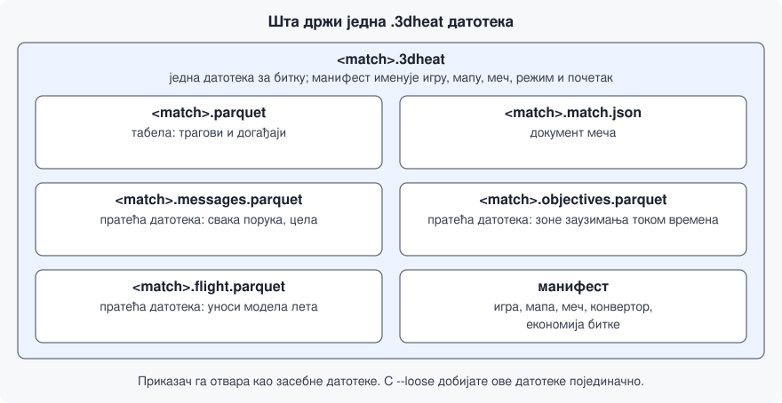
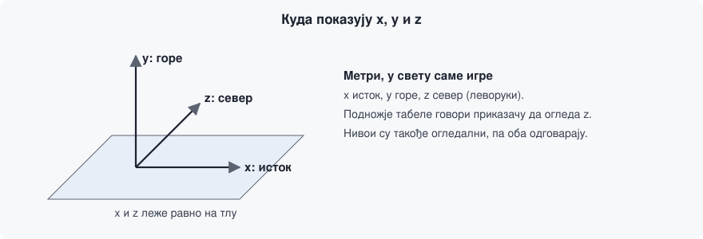

# Излазне датотеке {#output-files}

Подразумевано је свака битка **једна датотека**, `out/<map>/<match>.3dheat`: табела,
документ меча и пратеће датотеке спаковане заједно, с манифестом који именује
игру, мапу, меч, режим битке, време почетка и конвертор (и економију битке под
`extensions["heat3d/economy"]`). Формат је приказачев: [Једна датотека по мечу (.3dheat)](https://holdi601.github.io/3DHeat/container.html).

С `--loose` се исте датотеке пишу једна поред друге:

| Датотека | Шта је | Страница |
|---|---|---|
| `<match>.parquet` | по један ред за узорак или догађај | [Табела](table.md) |
| `<match>.match.json` | све остало што реплеј каже | [Документ меча](match-document.md) |
| `<match>.messages.parquet` | свака порука, вредност компоненте и пакет, цели | [Пратеће датотеке](sidecars.md) |
| `<match>.objectives.parquet` | зоне заузимања током времена | [Пратеће датотеке](sidecars.md) |
| `<match>.flight.parquet` | сваки унос модела лета сваког авиона, цео | [Пратеће датотеке](sidecars.md) |

Ако спаковање не успе, засебне датотеке се задржавају и ред то каже.

## Називи {#names}

`<match>` је `<map>_<AB|RB|SB>_<mode>_<start, UTC>_<session id>`, као на слици: видите
[Које датотеке су једна битка](converting.md#which-files-are-one-battle). `<map>` је
игрин сопствени ид мапе (`99_testmap` на сликама).

## Координате {#coordinates}

Метри, у игриним сопственим светом: x исток, y горе, z север. Наговештаји подножја
табеле говоре приказачу да окрене z, а нивои из `heat3d-wt-level` се пишу на исти
начин, па реплеј и његов ниво леже један на другом.

---

Део [3DHeat](https://github.com/Holdi601/3DHeat) ([документација](https://holdi601.github.io/3DHeat/)). Извор: [3DHeat-Ext-WarThunder](https://github.com/Holdi601/3DHeat-Ext-WarThunder).
