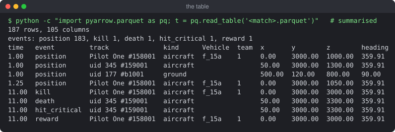

# Табела {#the-table}

Један ред по узорку или догађају, 105 колона ([Списак колона](../columns.md), генерисано из кода); у подножју, под `heat3d`, стоје упутства приказача за читање, па приказачу није потребно попуњавати ниједан образац.

| Колона | Шта је |
|---|---|
| `time` | секунде на сопственом сату реплеја |
| `event` | `position`; редови догађаја леже на трагу у свом тренутку (између два узорка, на линији између њих); `kill` (на убици), `death` (на жртви), `hit_critical` / `hit_severe` (на јединици која је погођена), `module_destroyed` (на јединици), `launch` (на јединици која је испустила оружје), `impact` (последњи узорак оружја кад је уклоњено одмах после); `explosion` и `flak` (0xD08E, 0xD01F) на свом положају, врста `effect`, без трака, са правцем експлозије где га има; `shot` (пројектил који је погодио, на стрелцу), `gun_shot`, `fire_start`, `fire_stop` (рафал топа, не возило у пламену), `fire_on`, `fire_off` (возило у пламену, видите [Пожари на возилу](hits.md#vehicle-fires)), `reward` (сребрни лавови и истраживачки поени зарађени, видите [Економија](economy.md)), `dead`, `bailout`, `repair`, `rearm`, `bullet_rearm`, `reload` (видите [Поруке упућене јединицама](how-it-reads.md#messages-to-units)); `despawn`: последњи ред трака чија је јединица нестала пре краја реплеја (видите [Крај трака](ground.md#end-of-a-track)) |
| `track` | оно што приказач црта као једну ствар: један живот јединице, или лет једног оружја - `<player or vehicle> #<hex>` (приказач показује назив без дела `#`) |
| `x`, `y`, `z` | игрини метри: x исток, y горе, z север (наговештаји окрећу z, па север није нацртан на југу) |
| `player` | име играча; AI јединица `<VehicleName> #<uid>` (на пример `F-15A #204`); `uid <n>` кад је ништа не именује; за оружје, ко га је испустио |
| `userId`, `team` | Gaijin ид играча и тим (`1`, `2`) |
| `ai`, `isPlayer` | `ai` је тачно за сваку јединицу коју не води ниједан налог играча (јединице мисије, AI авиони, копнене мете, ПВО топови, бродови без играча, замене), `isPlayer` је супротно: играч је јединица чији ентитет именује слот играча с Gaijin идом. Оружје има онај свог лансера; празно кад није познато |
| `match` | ид меча (`match` документа меча), на сваком реду; наговештаји га предају као сесију, па два учитана реплеја никад не спајају трагове |
| `life` | `uid#n`: трак једне јединице, пресечен кад uid пређе на другу јединицу, кад јединица иде брже него што може (оживљавање, поновно наоружавање, игра је помера, клијент исправља удаљену јединицу; видите Телепортовања у [Како чита реплеј](how-it-reads.md#what-is-read-and-the-check)) или је дуго није било видети; `w<hex>` лет оружја (`w<hex>#n` после реза) |
| `uid` | ид јединице у реплеју |
| `kind` | `aircraft`, `helicopter`, `tank`, `apc`, `spaa`, `truck`, `ship`, `boat`, `structure`, `train` (трамвај или железнички вагон који ниво поставља, видите [Јединице на сцени](objectives.md#scene-units-trams-and-rail-wagons)); оружја `missile`, `rocket`, `bomb`, `torpedo`, `payload`, `jettisoned`; `camera` реплеј камера снимајућег играча (видите [Камеру](ground.md#the-camera)) |
| `type` | игрин сопствени тип где резултати то именују (`fighter`, `assault`, `destroyer`, `gun_boat`), иначе као `kind` |
| `Vehicle` | игрин ид возила (`f_15a`, `germ_flakpz_I_Gepard`), с којим се слике возила приказача поклапају |
| `VehicleName`, `VehicleShortName`, `VehicleNameKey` | енглески назив возила из локализације ваше инсталације (`Pz.Kpfw. III Ausf. J1`, кратки `Pz.III J1`) и његов кључ (`germ_pzkpfw_III_ausf_J_0`); ознаке земаља у фонту игре се изостављају. Где игра ништа не именује, или инсталација није нађена, назив је ид а кључ празан |
| `mission` | назив јединице у мисији (`t1_tank_05`, `t2_player03_0`) |
| `dirX`, `dirY`, `dirZ` | куда јединица показује (вектор гледања): авиони из става модела лета, копнене јединице и бродови из својег става, оружје дуж свог лета |
| `heading`, `pitch`, `roll` | исто у степенима; правац је компас, у смеру казаљке од севера, нагиб нос горе позитиван, валљање десно крило доле позитивно (модел лета шаље супротан знак, видите [Став, проверено](aircraft.md#attitude-checked); десна страна копнене јединице доле). Наговештаји то говоре под `conventions` |
| `turretYaw`, `gunPitch`, `turrets` | главни торањ тенка - куда топ гађа, не куда играч гледа; вредност реплеја држана на брзини погона торња и постављена на линију сваког пуцња главног топа (видите [Торњеви](ground.md#turrets)): његов заокрет према трупу (степени, у смеру казаљке на сату гледано одозго позитивно, 0 право испред) и нагиб топа према трупу (степени, горе позитивно); `turrets` сваки торањ возила као `yaw pitch;yaw pitch;...` његовим редом (неискоришћени слот гласи `0.00 0.00`). Тенкови, SPAA, оклопни транспортери и камиони, у клијентским и серверским реплејима; не бродови (видите [Торњеви](ground.md#turrets)) |
| `turretYawRaw`, `gunPitchRaw` | главни торањ онако како га реплеј шаље; `turretYaw` / `gunPitch` су то држано на брзини погона торња и постављено на линију сваког пуцња главног топа (видите [Торњеви](ground.md#turrets)) |
| `viewYaw`, `viewPitch` | куда играч гледа (нишани камером) у свету: степени компаса (0 север, у смеру казаљке) и степени навише, иста конвенција као `aimHeading` / `aimPitch` (за разлику од `turretYaw` / `gunPitch`, који остају према трупу). Тенк сваког играча у серверском реплеју, сопствени тенк снимајућег играча у клијентском реплеју; празно где играч не нишани никуда (сва четири float-а нишања 0). Торањ га прати брзином свог окретања, па се два разликују док се окреће (видите [Торњеви](ground.md#turrets)) |
| `aimHeading`, `aimPitch`, `aimDistance` | сопствени тенк снимајућег играча: куда нишани (степени компаса, степени навише, даљина у m; 2000 кад ништа није у нишану); редови камере: куда играч нишани (правац, нагиб) |
| `zoom` | редови камере: увећање камере (видите [Камеру](ground.md#the-camera)) |
| `difficulty`, `gameMode` | `AB`, `RB` или `SB` битке, и `ground`, `air` или `naval`, на сваком реду (видите [Режим битке](ground.md#battle-mode)) |
| `extrapolated` | узорак авиона који је мртво рачунање клијента, не примљено стање (видите [Мртво рачунање](aircraft.md#dead-reckoning-and-the-smoother)); узорак бомбе израчунат из њеног испуштања (видите Бомбе без записа о лету у [Како чита реплеј](how-it-reads.md#what-is-read-and-the-check)) |
| `moved`, `xRaw`, `yRaw`, `zRaw`, `headingRaw`, `pitchRaw`, `rollRaw` | колико је заглађивач померио узорак (m), и сопствени положај и став реплеја (валљање у знаку табеле) |
| `targetX`, `targetY`, `targetZ` | тачка поготка `shot`-а |
| `hitOutcome`, `hitFlags` | исход `shot`-а на копненој јединици: `kill`, `critical`, `penetration` или `nonpenetration` (одбијен или заустављен: реплеј не разликује рикошет), из битова које сервер шаље с погоком (`hitFlags`, сирово); празно где се ништа не шаље (авиони, бродови). Видите [Исходи погодака](hits.md#hit-outcomes) |
| `hitShell` | потпис гранате `shot`-а: четири бајта поруке о погоку (сирови хекс); један потпис може значити различите гранате (120 и 125 mm APFSDS деле један), па се чува сирово, не чита као калибар |
| `ammoType`, `ammoName`, `ammoSlot`, `calibre` | муниција `shot`-а: њена врста (`APFSDS`, `APDS`, `HE`, `HEAT-FS`, `HESH`, `ATGM`...) и ид (`125mm_3bm46`) где убиство именује слот стрелца, иначе `explosive` (распрскавајући погодак) или `kinetic`; `weapon/slot` топа из његовог пуњења; калибар у mm из датотека оружја инсталације. Видите [Исходи погодака](hits.md#hit-outcomes) |
| `rpm` | обртаји мотора авиона (просек по моторима) онако како су последњи пут послати, у оквиру 2 s |
| `vx`, `vy`, `vz` | брзина авиона онако како је шаље његов унос лета (m/s, осе игре; брзине преко 500 m/s читају се као 500) |
| `engine`, `afterburner`, `engineCondition` | мотори авиона из његовог уноса лета: `off`, `starting`, `running`, `dead` (спојено с `/` кад се мотори разликују); накнадно сагоревање 0-1; бајт послат само после погодка у мотор |
| `weaponName` | убиства и смрти: оружје или муниција на енглеском из ваше инсталације (`AIM-120C-5 AMRAAM air-to-air missiles`, `Fragmentation incendiary tracer shell`) |
| `throttle`, `elevator`, `aileron`, `rudder`, `ammo` | само авион снимајућег играча: гас 0-1,1 из његове кабине (1,1 ратно појачање или накнадно сагоревање; иначе петнаестине из његовог уноса лета), управљање -1..1 из његовог уноса лета (лифт позитиван кад вуче, елерон позитиван кад ваља удесно), преостали меци по оружју (`250 140 170`) |
| `ias`, `vario`, `fuel`, `manifoldPressure`, `gear`, `oilTemperature`, `headTemperature` | само авион снимајућег играча, из његове кабине: индицирана брзина ваздуха и брзина пењања (m/s), гориво, притисак у усисној грани (atm), стајни трап (0-1, 1 доле), температура уља и глава цилиндра, где кабина има мерач |
| `speed` | m/s током око две секунде трака (израчунато овде; реплеј не шаље брзину за друге јединице) |
| `alive` | 0 за узорке јединице после њене смрти (њена олупина): копнене јединице или брода док их игра не уклони или док њихови узорци не престану, авиона највише 60 s |
| `otherVehicle`, `otherLife` | жртва `shot`-а: њено возило и њен `life` |
| `hitLocalX`, `hitLocalY`, `hitLocalZ`, `hitDirX`, `hitDirY`, `hitDirZ` | тачка поготка `shot`-а у сопственом систему жртве (m; x напред, y горе, z лево) и начин на који је пуцањ дошао, претворен у тај систем ставом жртве тада (видите [Поруке упућене јединицама](how-it-reads.md#messages-to-units)) |
| `hitPart`, `hitFlag` | порука о погоку `shot`-а: његова реч дела онако како је послата, и њен горњи бајт |
| `cost_fired_sl`, `cost_lost_sl`, `earn_sl`, `earn_rp`, `rewardType`, `currency`, `econ_basis`, `won` | колико је битка коштала и шта је зарадила, и ко је победио: видите [Економија](economy.md) |
| `other`, `weapon` | убиства: друга страна и оружје; погоци: ко је погодио (из uid-а записа, иначе из слота играча), њихово возило; лансирања: оружје; уништени модули: ко је последњи погодио јединицу у 5 s пре тога, и `part <n>` |

---

Део [3DHeat](https://github.com/Holdi601/3DHeat) ([документација](https://holdi601.github.io/3DHeat/)). Извор: [3DHeat-Ext-WarThunder](https://github.com/Holdi601/3DHeat-Ext-WarThunder).
