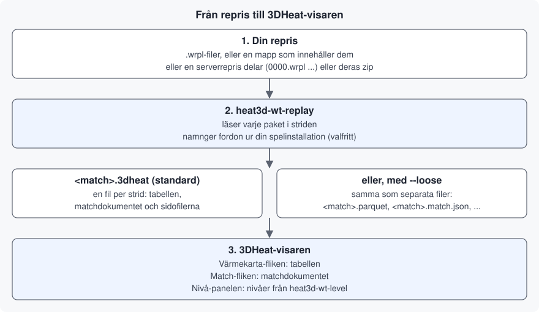

# 3DHeat War Thunder-repriser {#dheat-war-thunder-replays}

**Vad är det?** War Thunder kan spela in en strid som en repris-fil. Det här
verktyget gör inspelningen till en fil du kan titta på uppifrån i
[3DHeat-visaren](https://holdi601.github.io/3DHeat/), med varje flygplan, stridsvagn
och fartyg, varje robot och bomb, och varje träff där den hände. Ett andra
kommando gör nivåerna i din egen spelinstallation till 3D-nivåer att visa
striderna på.

**Varför skulle jag använda det?** För en genomgång av en strid i 3D; för
värmekartor över var du och andra flyger, kör, slåss och dör under många strider;
för att se var träffarna landade på ett fordon; för att se vad en strid kostade
och gav. Resultatet är vanlig Parquet och JSON, så andra verktyg kan läsa det
också.

**Exempel:** en `.wrpl`-repris in, en `<match>.3dheat`-fil ut:



## Snabbstart {#quick-start}

Ny i kommandoraden? Läs [Innan du börjar](before-you-start.md) först.

```bash
git clone https://github.com/Holdi601/3DHeat-Ext-WarThunder.git
cd 3DHeat-Ext-WarThunder
pip install -e .                                  # installerar heat3d-wt-replay och heat3d-wt-level
heat3d-wt-replay "<War Thunder>/Replays" -o out
```

Du bör se en rad per strid: `ok out/<map>/<match>.3dheat`. Öppna den filen
i 3DHeat-visaren.

## Den här dokumentationen {#this-documentation}

| Sida | Vad den tar upp |
|---|---|
| [Innan du börjar](before-you-start.md) | Python, en terminal och hur lyckad körning ser ut |
| [Installera](installing.md) | installation, namn från din installation, uppdateringar |
| [Konvertera repriser](converting.md) | `heat3d-wt-replay` steg för steg, varje alternativ, meddelanden |
| [Utdatafiler](output-files.md) | `.3dheat`-filen, `--loose`-filer, namn |
| [Tabellen](table.md) | varje kolumn och händelse |
| [Matchdokumentet](match-document.md) | varje nyckel i `<match>.match.json` |
| [Sidofiler och fullständighet](sidecars.md) | vad som sparas helt vid sidan av tabellen, och antalen |
| [Nivåer](levels.md) | `heat3d-wt-level`: nivåer från din installation som `.glb` |
| [Så läser den en repris](how-it-reads.md) | vad som läses, och hur det kontrollerades |
| [Flygplan](aircraft.md), [Markenheter och kamera](ground.md), [Träffar, beskjutning och bränder](hits.md) | detaljerna bakom kolumnerna |
| [Ekonomi](economy.md), [Mål](objectives.md) | Silver Lions och forskningspoäng; erövringszoner, flygfält |
| [Villkor och licens](terms.md) | Gaijins villkor, källor, tester, licens |
| [Kommandoreferens](../cli-reference.md), [Kolumnlista](../columns.md) | genererade från koden |

## Del av 3DHeat {#part-of-3dheat}

Den här konverteraren är ett av verktygen i [3DHeat](https://github.com/Holdi601/3DHeat),
en realtidsvisare för 3D-telemetri och repriser ([dokumentation](https://holdi601.github.io/3DHeat/)).
Visaren öppnar `.3dheat`-filen: tabellen på sin Värmekarta-flik, matchdokumentet på
sin Match-flik ([En fil per match](https://holdi601.github.io/3DHeat/container.html)).
Vad varje konverterare måste behålla: [Konverterare behåller allt](https://holdi601.github.io/3DHeat/converters.html).

**Varför det är ett eget verktyg.** `.wrpl`-formatet är inte dokumenterat, och
Gaijins EULA (3.2.2, 3.2.9) förbjuder att reverse engineera spelet och gräva fram
data som inte är avsedd att visas; den nämner inte repriser, som spelet själv visar
spelaren. För att en licensfråga bara ska beröra den här konverteraren ligger den
utanför 3DHeat Watcher: Watcher kör den på nya repriser när den är installerad,
och fungerar utan den.

| Verktyg | Vad det gör | Källa | Dokumentation |
|---|---|---|---|
| 3DHeat-visaren | visar datan i 3D: värmekartor, repriser, loppanalys | [3DHeat](https://github.com/Holdi601/3DHeat) | [webbplats](https://holdi601.github.io/3DHeat/) |
| GameFiles | banor och nivåer ur filerna som spel levereras med | [3DHeat-GameFiles](https://github.com/Holdi601/3DHeat-GameFiles) | [webbplats](https://holdi601.github.io/3DHeat-GameFiles/) |
| GameCapture | varvtelemetri, och nivåer byggda från spelvideo | [3DHeat-GameCapture](https://github.com/Holdi601/3DHeat-GameCapture) | [webbplats](https://holdi601.github.io/3DHeat-GameCapture/) |
| Unreal Exporter | ett Unreal Editor-tillägg som exporterar en nivå | [3DHeat-UnrealExporter](https://github.com/Holdi601/3DHeat-UnrealExporter) | [webbplats](https://holdi601.github.io/3DHeat-UnrealExporter/) |
| CS2 | Counter-Strike 2-demos och banor | [3DHeat-CS2](https://github.com/Holdi601/3DHeat-CS2) | [webbplats](https://holdi601.github.io/3DHeat-CS2/) |
| Watcher | spelar in det spel publicerar medan du spelar | [3DHeat-Watcher](https://github.com/Holdi601/3DHeat-Watcher) | [webbplats](https://holdi601.github.io/3DHeat-Watcher/) |
| War Thunder-repriser | `.wrpl`-repriser och War Thunder-nivåer | [3DHeat-Ext-WarThunder](https://github.com/Holdi601/3DHeat-Ext-WarThunder) | [webbplats](https://holdi601.github.io/3DHeat-Ext-WarThunder/) |
| World of Tanks-repriser | `.wotreplay`-repriser | [3DHeat-Ext-WoT](https://github.com/Holdi601/3DHeat-Ext-WoT) | [webbplats](https://holdi601.github.io/3DHeat-Ext-WoT/) |
| World of Warships-repriser | `.wowsreplay`-repriser | [3DHeat-Ext-WoWs](https://github.com/Holdi601/3DHeat-Ext-WoWs) | [webbplats](https://holdi601.github.io/3DHeat-Ext-WoWs/) |
| Squad-demos | demos från Squad-servrar | [3DHeat-Ext-Squad](https://github.com/Holdi601/3DHeat-Ext-Squad) | [webbplats](https://holdi601.github.io/3DHeat-Ext-Squad/) |
| DCS-banor | DCS World-banor som 3D-nivåer | [3DHeat-Ext-DCS](https://github.com/Holdi601/3DHeat-Ext-DCS) | [webbplats](https://holdi601.github.io/3DHeat-Ext-DCS/) |
| IL-2-banor | IL-2 Great Battles-banor som 3D-nivåer | [3DHeat-Ext-IL2](https://github.com/Holdi601/3DHeat-Ext-IL2) | [webbplats](https://holdi601.github.io/3DHeat-Ext-IL2/) |

---

Del av [3DHeat](https://github.com/Holdi601/3DHeat) ([dokumentation](https://holdi601.github.io/3DHeat/)). Källa: [3DHeat-Ext-WarThunder](https://github.com/Holdi601/3DHeat-Ext-WarThunder).
