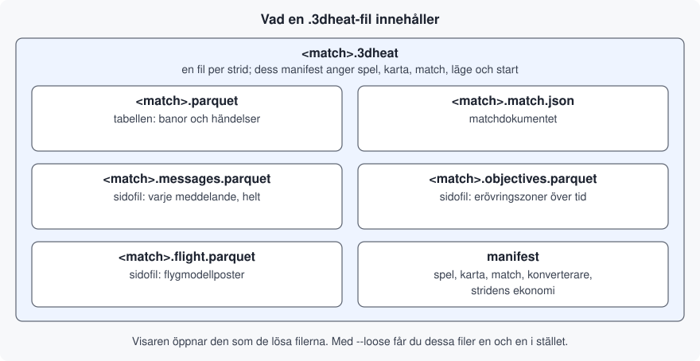
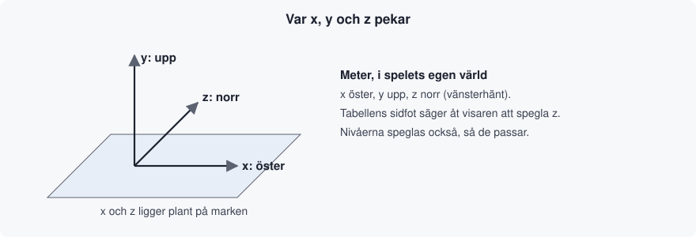

# Utdatafiler {#output-files}

Som standard blir varje strid **en fil**, `out/<map>/<match>.3dheat`: tabellen,
matchdokumentet och sidofilerna packade tillsammans, med ett manifest som
namnger spelet, kartan, matchen, stridsläget, starttiden och konverteraren (och
stridens ekonomi under `extensions["heat3d/economy"]`). Formatet är visarens:
[En fil per match (.3dheat)](https://holdi601.github.io/3DHeat/container.html).

Med `--loose` skrivs samma filer i stället bredvid varandra:

| Fil | Vad | Sida |
|---|---|---|
| `<match>.parquet` | en rad per mätpunkt eller händelse | [Tabellen](table.md) |
| `<match>.match.json` | allt annat som repriserna säger | [Matchdokumentet](match-document.md) |
| `<match>.messages.parquet` | varje meddelande, komponentvärde och paket, helt | [Sidofiler](sidecars.md) |
| `<match>.objectives.parquet` | erövringszonerna över tid | [Sidofiler](sidecars.md) |
| `<match>.flight.parquet` | varje flygmodellpost för varje flygplan, helt | [Sidofiler](sidecars.md) |

Om packningen misslyckas behålls de lösa filerna, och raden säger det.

## Namn {#names}

`<match>` är `<map>_<AB|RB|SB>_<mode>_<start, UTC>_<session id>`, som på bilden:
se [Vilka filer som är en strid](converting.md#which-files-are-one-battle).
`<map>` är spelets eget id för kartan (`99_testmap` på bilderna).

## Koordinater {#coordinates}

Meter, i spelets egen värld: x öster, y upp, z norr. Tabellens fotnot
säger åt visaren att spegla z, och nivåer från `heat3d-wt-level` skrivs på
samma sätt, så en repris och dess nivå ligger ovanpå varandra.

---

Del av [3DHeat](https://github.com/Holdi601/3DHeat) ([dokumentation](https://holdi601.github.io/3DHeat/)). Källa: [3DHeat-Ext-WarThunder](https://github.com/Holdi601/3DHeat-Ext-WarThunder).
