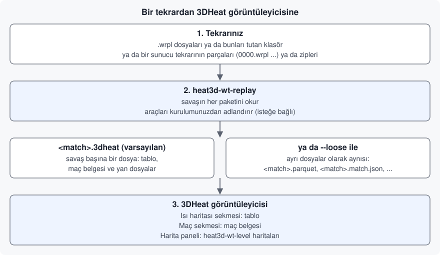

# 3DHeat War Thunder tekrarları {#dheat-war-thunder-replays}

**Bu nedir?** War Thunder bir savaşı tekrar dosyası olarak kaydedebilir. Bu araç
kaydı, [3DHeat görüntüleyicisinde](https://holdi601.github.io/3DHeat/) üstten izleyebileceğiniz
bir dosyaya çevirir. Her uçak, tank ve gemi, her füze ve bomba, her isabet de
tam olduğu yerde görünür. İkinci bir komut, kendi oyun kurulumunuzdaki haritaları
savaşları göstermek için 3B haritalara çevirir.

**Neden kullanmalısınız?** Bir savaşı 3B olarak gözden geçirmek için; birçok savaş
boyunca sizin ve diğerlerinin nerede uçtuğunu, sürdüğünü, savaştığını ve öldüğünü
gösteren ısı haritaları için; bir araca isabetlerin nereye geldiğini görmek için;
bir savaşın neye mal olduğunu ve ne kazandırdığını görmek için. Çıktı düz Parquet
ve JSON dosyasıdır, bu yüzden başka araçlar da okuyabilir.

**Örnek:** Girdi bir `.wrpl` tekrar dosyası, çıktı bir `<maç>.3dheat` dosyası:



## Hızlı başlangıç {#quick-start}

Komut satırına yeni misiniz? Önce [Başlamadan önce](before-you-start.md) sayfasını okuyun.

```bash
git clone https://github.com/Holdi601/3DHeat-Ext-WarThunder.git
cd 3DHeat-Ext-WarThunder
pip install -e .                                  # heat3d-wt-replay ve heat3d-wt-level kurar
heat3d-wt-replay "<War Thunder>/Replays" -o out
```

Her savaş için bir satır görmelisiniz: `ok out/<map>/<match>.3dheat`. Bu dosyayı
3DHeat görüntüleyicisinde açın.

## Bu belgeler {#this-documentation}

| Sayfa | Neyi anlatır |
|---|---|
| [Başlamadan önce](before-you-start.md) | Python, bir terminal ve başarının neye benzediği |
| [Kurulum](installing.md) | kurulum, kurulumunuzdan adlar, güncellemeler |
| [Tekrarları çevirme](converting.md) | `heat3d-wt-replay` adım adım, her seçenek, iletiler |
| [Çıktı dosyaları](output-files.md) | `.3dheat` dosyası, `--loose` dosyaları, adlar |
| [Tablo](table.md) | her sütun ve olay |
| [Maç belgesi](match-document.md) | `<maç>.match.json` dosyasının her anahtarı |
| [Yan dosyalar ve tamlık](sidecars.md) | tablonun yanında tam tutulan şeyler ve sayılar |
| [Haritalar](levels.md) | `heat3d-wt-level`: kurulumunuzdaki haritalar `.glb` olarak |
| [Tekrarı nasıl okur](how-it-reads.md) | neyin okunduğu ve nasıl sınandığı |
| [Uçaklar](aircraft.md), [Kara birimleri ve kamera](ground.md), [İsabetler, ateş ve yangınlar](hits.md) | sütunların ardındaki ayrıntılar |
| [Ekonomi](economy.md), [Hedefler](objectives.md) | Gümüş Aslanlar ve araştırma puanları; ele geçirme bölgeleri, hava alanları |
| [Terimler ve lisans](terms.md) | Gaijin'in koşulları, kaynaklar, testler, lisans |
| [Komut başvurusu](../cli-reference.md), [Sütun listesi](../columns.md) | koddan üretilmiştir |

## 3DHeat'in parçası {#part-of-3dheat}

Bu dönüştürücü, [3DHeat](https://github.com/Holdi601/3DHeat) araçlarından biridir.
3DHeat, gerçek zamanlı bir 3B telemetri ve tekrar görüntüleyicisidir
([belgeler](https://holdi601.github.io/3DHeat/)). Görüntüleyici `.3dheat` dosyasını açar:
Isı haritası sekmesinde tablo, Maç sekmesinde maç belgesi
([Bir maç tek dosyada](https://holdi601.github.io/3DHeat/container.html)).
Her dönüştürücünün tutması gerekenler: [Dönüştürücüler her şeyi tutar](https://holdi601.github.io/3DHeat/converters.html).

**Neden ayrı bir araç?** `.wrpl` biçimi belgelenmemiştir. Gaijin'in lisans sözleşmesi
(3.2.2, 3.2.9) oyunun tersine mühendisliğini ve gösterilmesi amaçlanmamış verilerin
madenciliğini yasaklar; tekrarları adıyla anmaz, oyun da tekrarları oyuncuya kendisi
gösterir. Bir lisans sorusunun yalnızca bu dönüştürücüye dokunması için araç 3DHeat
Watcher'ın dışında durur: Watcher kuruluysa yeni tekrarlarda bunu çalıştırır, ama
bu araç olmadan da çalışır.

| Araç | Ne yapar | Kaynak | Belgeler |
|---|---|---|---|
| 3DHeat görüntüleyicisi | verileri 3B gösterir: ısı haritaları, tekrarlar, yarış analizi | [3DHeat](https://github.com/Holdi601/3DHeat) | [site](https://holdi601.github.io/3DHeat/) |
| GameFiles | oyunların taşıdığı dosyalardan pistler ve haritalar | [3DHeat-GameFiles](https://github.com/Holdi601/3DHeat-GameFiles) | [site](https://holdi601.github.io/3DHeat-GameFiles/) |
| GameCapture | tur telemetrisi ve oyun videosundan yeniden kurulan haritalar | [3DHeat-GameCapture](https://github.com/Holdi601/3DHeat-GameCapture) | [site](https://holdi601.github.io/3DHeat-GameCapture/) |
| Unreal Exporter | bir haritayı dışa aktaran bir Unreal Editor eklentisi | [3DHeat-UnrealExporter](https://github.com/Holdi601/3DHeat-UnrealExporter) | [site](https://holdi601.github.io/3DHeat-UnrealExporter/) |
| CS2 | Counter-Strike 2 demoları ve haritaları | [3DHeat-CS2](https://github.com/Holdi601/3DHeat-CS2) | [site](https://holdi601.github.io/3DHeat-CS2/) |
| Watcher | oynarken oyunların yayımladıklarını kaydeder | [3DHeat-Watcher](https://github.com/Holdi601/3DHeat-Watcher) | [site](https://holdi601.github.io/3DHeat-Watcher/) |
| War Thunder tekrarları | `.wrpl` tekrarları ve War Thunder haritaları | [3DHeat-Ext-WarThunder](https://github.com/Holdi601/3DHeat-Ext-WarThunder) | [site](https://holdi601.github.io/3DHeat-Ext-WarThunder/) |
| World of Tanks tekrarları | `.wotreplay` tekrarları | [3DHeat-Ext-WoT](https://github.com/Holdi601/3DHeat-Ext-WoT) | [site](https://holdi601.github.io/3DHeat-Ext-WoT/) |
| World of Warships tekrarları | `.wowsreplay` tekrarları | [3DHeat-Ext-WoWs](https://github.com/Holdi601/3DHeat-Ext-WoWs) | [site](https://holdi601.github.io/3DHeat-Ext-WoWs/) |
| Squad demoları | Squad sunucu demoları | [3DHeat-Ext-Squad](https://github.com/Holdi601/3DHeat-Ext-Squad) | [site](https://holdi601.github.io/3DHeat-Ext-Squad/) |
| DCS haritaları | DCS World haritaları 3B harita olarak | [3DHeat-Ext-DCS](https://github.com/Holdi601/3DHeat-Ext-DCS) | [site](https://holdi601.github.io/3DHeat-Ext-DCS/) |
| IL-2 haritaları | IL-2 Great Battles haritaları 3B harita olarak | [3DHeat-Ext-IL2](https://github.com/Holdi601/3DHeat-Ext-IL2) | [site](https://holdi601.github.io/3DHeat-Ext-IL2/) |

---

[3DHeat](https://github.com/Holdi601/3DHeat) parçası ([belgeler](https://holdi601.github.io/3DHeat/)). Kaynak: [3DHeat-Ext-WarThunder](https://github.com/Holdi601/3DHeat-Ext-WarThunder).
