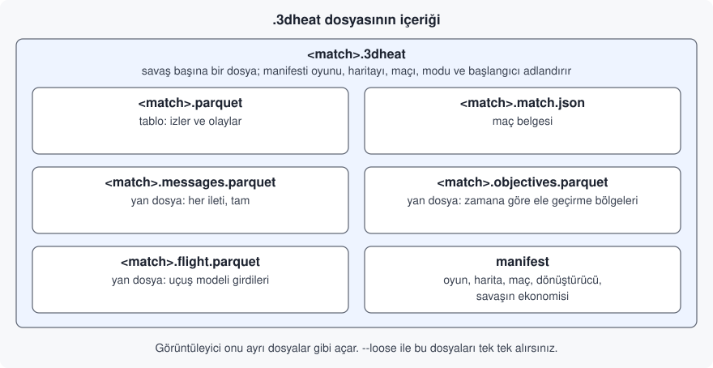
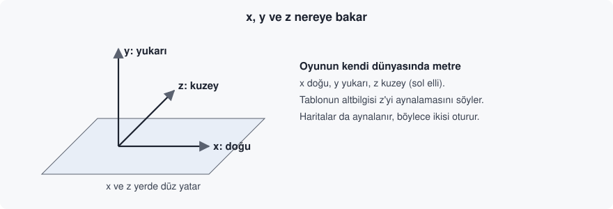

# Çıktı dosyaları {#output-files}

Varsayılan olarak her savaş **tek bir dosyadır**, `out/<map>/<match>.3dheat`: tablo, maç
belgesi ve yan dosyalar bir arada paketlenmiş, bir manifestte oyun, harita, maç, savaş modu,
başlangıç zamanı ve dönüştürücü adıyla (ve savaşın ekonomisi `extensions["heat3d/economy"]`
altında). Biçim görüntüleyicinin biçimidir:
[Bir maç tek dosyada (.3dheat)](https://holdi601.github.io/3DHeat/container.html).

`--loose` ile aynı dosyalar bunun yerine yan yana yazılır:

| Dosya | İçerik | Sayfa |
|---|---|---|
| `<match>.parquet` | her örnek ya da olay için bir satır | [Tablo](table.md) |
| `<match>.match.json` | tekrarın söylediği diğer her şey | [Maç belgesi](match-document.md) |
| `<match>.messages.parquet` | her ileti, bileşen değeri ve paket, tam olarak | [Yan dosyalar](sidecars.md) |
| `<match>.objectives.parquet` | zamana göre ele geçirme bölgeleri | [Yan dosyalar](sidecars.md) |
| `<match>.flight.parquet` | her uçağın her uçuş modeli girdisi, tam olarak | [Yan dosyalar](sidecars.md) |

Paketleme başarısız olursa ayrı dosyalar korunur ve satır bunu söyler.

## Adlar {#names}

`<match>`, resimdeki gibi `<map>_<AB|RB|SB>_<mode>_<start, UTC>_<session id>` biçimindedir:
bkz. [Hangi dosyalar bir savaştır](converting.md#which-files-are-one-battle).
`<map>`, haritanın oyundaki kendi kimliğidir (resimlerde `99_testmap`).

## Koordinatlar {#coordinates}

Metre cinsinden, oyunun kendi dünyasında: x doğu, y yukarı, z kuzey. Tablonun altbilgisi
görüntüleyiciye z'yi aynalamasını söyler; `heat3d-wt-level` haritaları da aynı biçimde
yazılır, bu yüzden bir tekrar ile onun haritası üst üste oturur.

---

[3DHeat](https://github.com/Holdi601/3DHeat) parçası ([belgeler](https://holdi601.github.io/3DHeat/)). Kaynak: [3DHeat-Ext-WarThunder](https://github.com/Holdi601/3DHeat-Ext-WarThunder).
