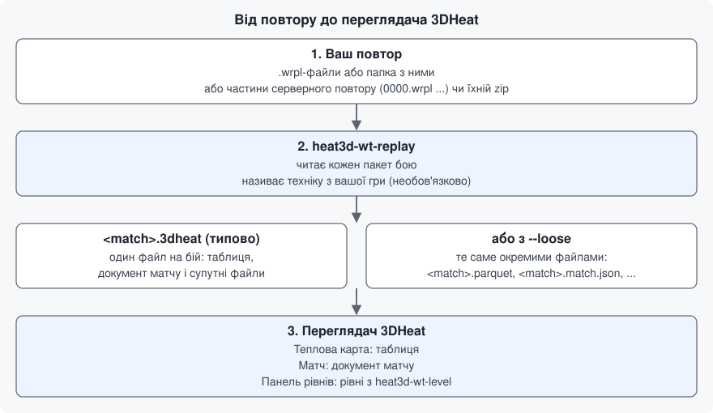

# Відтворення боїв War Thunder у 3DHeat {#dheat-war-thunder-replays}

**Що це?** War Thunder може записати бій як файл повтору. Цей інструмент
перетворює запис на файл, який можна переглянути зверху в
[переглядачі 3DHeat](https://holdi601.github.io/3DHeat/): кожен літак, танк
і корабель, кожна ракета і бомба, кожне влучання там, де воно сталося. Друга
команда перетворює рівні вашої встановленої гри на 3D-рівні, на яких показують
бої.

**Навіщо це потрібно?** Щоб розібрати бій у 3D; для теплових карт того, де ви
і інші літаєте, їздите, б'єтеся та гинете за багато боїв; щоб побачити, де
потрапляли влучання в техніку; щоб побачити, що бій коштував і що приніс.
Результат — звичайні файли Parquet і JSON, тож їх можуть прочитати й інші
програми.

**Приклад:** на вхід один повтор `.wrpl`, на виході один файл
`<match>.3dheat`:



## Швидкий старт {#quick-start}

Ви ще не працювали з командним рядком? Спочатку прочитайте
[Перш ніж почати](before-you-start.md).

```bash
git clone https://github.com/Holdi601/3DHeat-Ext-WarThunder.git
cd 3DHeat-Ext-WarThunder
pip install -e .                                  # встановлює heat3d-wt-replay і heat3d-wt-level
heat3d-wt-replay "<War Thunder>/Replays" -o out
```

Ви побачите по одному рядку на бій: `ok out/<map>/<match>.3dheat`. Відкрийте
цей файл у переглядачі 3DHeat.

## Ця документація {#this-documentation}

| Сторінка | Про що вона |
|---|---|
| [Перш ніж почати](before-you-start.md) | Python, термінал і як виглядає успіх |
| [Встановлення](installing.md) | встановлення, назви з вашої гри, оновлення |
| [Перетворення повторів](converting.md) | `heat3d-wt-replay` крок за кроком, кожна опція, повідомлення |
| [Файли результату](output-files.md) | файл `.3dheat`, файли `--loose`, назви |
| [Таблиця](table.md) | кожна колонка і подія |
| [Документ матчу](match-document.md) | кожен ключ `<match>.match.json` |
| [Супутні файли і повнота](sidecars.md) | що зберігається цілком поряд із таблицею, і лічильники |
| [Рівні](levels.md) | `heat3d-wt-level`: рівні з вашої гри у форматі `.glb` |
| [Як читається повтор](how-it-reads.md) | що читається і як це перевірено |
| [Техніка](aircraft.md), [Наземні юніти і камера](ground.md), [Влучання, стрільба і пожежі](hits.md) | подробиці за колонками |
| [Економіка](economy.md), [Цілі](objectives.md) | Срібні леви і дослідницькі очки; зони захоплення, аеродроми |
| [Терміни і ліцензія](terms.md) | що читається, джерела, тести, ліцензія |
| [Довідка з командами](../cli-reference.md), [Список колонок](../columns.md) | створено з коду |

## Частина 3DHeat {#part-of-3dheat}

Цей конвертер — один з інструментів [3DHeat](https://github.com/Holdi601/3DHeat),
переглядача 3D-телеметрії й повторів у реальному часі
([документація](https://holdi601.github.io/3DHeat/)). Переглядач відкриває файл
`.3dheat`: таблицю — на його вкладці «Теплова карта», документ матчу — на вкладці «Матч»
([Один файл на матч](https://holdi601.github.io/3DHeat/container.html)).
Що має зберігати кожен конвертер:
[Конвертери зберігають усе](https://holdi601.github.io/3DHeat/converters.html).

Кожен модуль читання гри - окремий невеликий проєкт із власним файлом ліцензії, випусками й трекером задач, тож його можна встановлювати, оновлювати, підтримувати - або відкликати на прохання правовласника - окремо, не зачіпаючи переглядач та інші інструменти.
3DHeat Watcher запускає цей конвертер для нових повторів, коли він встановлений, і працює без нього.

| Інструмент | Що робить | Джерело | Документація |
|---|---|---|---|
| Переглядач 3DHeat | показує дані у 3D: теплові карти, повтори, аналіз заїздів | [3DHeat](https://github.com/Holdi601/3DHeat) | [сайт](https://holdi601.github.io/3DHeat/) |
| GameFiles | маршрути і рівні з файлів, які постачають ігри | [3DHeat-GameFiles](https://github.com/Holdi601/3DHeat-GameFiles) | [сайт](https://holdi601.github.io/3DHeat-GameFiles/) |
| GameCapture | телеметрія кругів і рівні, відтворені з відеозапису гри | [3DHeat-GameCapture](https://github.com/Holdi601/3DHeat-GameCapture) | [сайт](https://holdi601.github.io/3DHeat-GameCapture/) |
| Unreal Exporter | плагін редактора Unreal Editor, який експортує рівень | [3DHeat-UnrealExporter](https://github.com/Holdi601/3DHeat-UnrealExporter) | [сайт](https://holdi601.github.io/3DHeat-UnrealExporter/) |
| CS2 | демо і карти Counter-Strike 2 | [3DHeat-CS2](https://github.com/Holdi601/3DHeat-CS2) | [сайт](https://holdi601.github.io/3DHeat-CS2/) |
| Watcher | записує те, що ігри публікують, поки ви граєте | [3DHeat-Watcher](https://github.com/Holdi601/3DHeat-Watcher) | [сайт](https://holdi601.github.io/3DHeat-Watcher/) |
| Повтори War Thunder | повтори `.wrpl` і рівні War Thunder | [3DHeat-Ext-WarThunder](https://github.com/Holdi601/3DHeat-Ext-WarThunder) | [сайт](https://holdi601.github.io/3DHeat-Ext-WarThunder/) |
| Повтори World of Tanks | повтори `.wotreplay` | [3DHeat-Ext-WoT](https://github.com/Holdi601/3DHeat-Ext-WoT) | [сайт](https://holdi601.github.io/3DHeat-Ext-WoT/) |
| Повтори World of Warships | повтори `.wowsreplay` | [3DHeat-Ext-WoWs](https://github.com/Holdi601/3DHeat-Ext-WoWs) | [сайт](https://holdi601.github.io/3DHeat-Ext-WoWs/) |
| Демо Squad | демо серверів Squad | [3DHeat-Ext-Squad](https://github.com/Holdi601/3DHeat-Ext-Squad) | [сайт](https://holdi601.github.io/3DHeat-Ext-Squad/) |
| Карти DCS | карти DCS World як 3D-рівні | [3DHeat-Ext-DCS](https://github.com/Holdi601/3DHeat-Ext-DCS) | [сайт](https://holdi601.github.io/3DHeat-Ext-DCS/) |
| Карти IL-2 | карти IL-2 Great Battles як 3D-рівні | [3DHeat-Ext-IL2](https://github.com/Holdi601/3DHeat-Ext-IL2) | [сайт](https://holdi601.github.io/3DHeat-Ext-IL2/) |

---

Частина [3DHeat](https://github.com/Holdi601/3DHeat) ([документація](https://holdi601.github.io/3DHeat/)). Джерело: [3DHeat-Ext-WarThunder](https://github.com/Holdi601/3DHeat-Ext-WarThunder).
