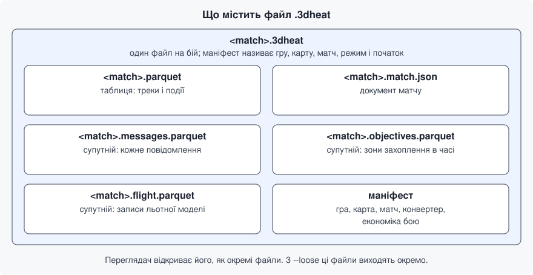
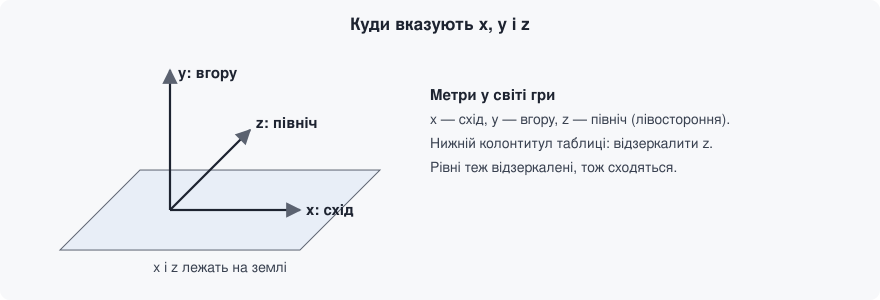

# Файли результату {#output-files}

Типово кожен бій — це **один файл**, `out/<map>/<match>.3dheat`: таблиця, документ
матчу і супутні файли, упаковані разом, з маніфестом, який називає гру, карту,
матч, режим бою, час початку і конвертер (а також економіку бою в
`extensions["heat3d/economy"]`). Формат належить переглядачу:
[Один файл на матч (.3dheat)](https://holdi601.github.io/3DHeat/container.html).

З опцією `--loose` ті самі файли записуються поруч окремо:

| Файл | Що в ньому | Сторінка |
|---|---|---|
| `<match>.parquet` | один рядок на відлік або подію | [Таблиця](table.md) |
| `<match>.match.json` | усе інше, що розповідає повтор | [Документ матчу](match-document.md) |
| `<match>.messages.parquet` | кожне повідомлення, значення компонента і пакет, цілком | [Супутні файли](sidecars.md) |
| `<match>.objectives.parquet` | зони захоплення в часі | [Супутні файли](sidecars.md) |
| `<match>.flight.parquet` | кожен запис льотної моделі кожного літака, цілком | [Супутні файли](sidecars.md) |

Якщо упаковка не вдалася, окремі файли лишаються, і рядок про це повідомляє.

## Назви {#names}

`<match>` — це `<map>_<AB|RB|SB>_<mode>_<start, UTC>_<session id>`, як на малюнку:
див. [Які файли — це один бій](converting.md#which-files-are-one-battle).
`<map>` — це власний ідентифікатор карти в грі (`99_testmap` на малюнках).

## Координати {#coordinates}

Метри у світі самої гри: x — на схід, y — вгору, z — на північ. Нижній колонтитул
таблиці наказує переглядачу відзеркалити z, і рівні з `heat3d-wt-level` записані
так само, тож повтор і його рівень лягають один на одного.

---

Частина [3DHeat](https://github.com/Holdi601/3DHeat) ([документація](https://holdi601.github.io/3DHeat/)). Джерело: [3DHeat-Ext-WarThunder](https://github.com/Holdi601/3DHeat-Ext-WarThunder).
