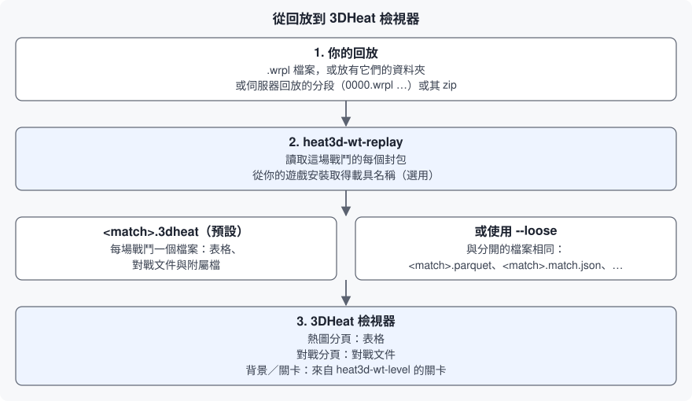

# 3DHeat 戰爭雷霆回放 {#dheat-war-thunder-replays}

**這是什麼？**War Thunder 可以把一場戰鬥錄成回放檔。這個工具會把錄製內容轉成一個檔案，讓你可以從上方的 [3DHeat 檢視器](https://holdi601.github.io/3DHeat/)觀看：每架飛機、每輛坦克與每艘船、每枚飛彈與炸彈，以及每次命中發生的位置。第二個指令會把你自己遊戲安裝中的地圖變成 3D 地圖，讓戰鬥在上面呈現。

**為什麼要用它？**用 3D 檢討一場戰鬥；想看多場戰鬥中，你與其他人飛行、駕駛、交戰與陣亡的熱度圖；查看命中落在載具的哪個位置；查看一場戰鬥花費與賺得多少。輸出是一般的 Parquet 與 JSON，因此其他工具也能讀取。

**範例：**輸入一個 `.wrpl` 回放，輸出一個 `<match>.3dheat` 檔案：



## 快速開始 {#quick-start}

第一次使用命令列嗎？請先閱讀[開始之前](before-you-start.md)。

```bash
git clone https://github.com/Holdi601/3DHeat-Ext-WarThunder.git
cd 3DHeat-Ext-WarThunder
pip install -e .                                  # 安裝 heat3d-wt-replay 與 heat3d-wt-level
heat3d-wt-replay "<War Thunder>/Replays" -o out
```

你會看到每場戰鬥一行：`ok out/<map>/<match>.3dheat`。請在 3DHeat 檢視器中開啟該檔案。

## 本說明文件 {#this-documentation}

| 頁面 | 涵蓋內容 |
|---|---|
| [開始之前](before-you-start.md) | Python、終端機，以及成功的樣子 |
| [安裝](installing.md) | 安裝、來自你安裝目錄的名稱、更新 |
| [轉換回放](converting.md) | `heat3d-wt-replay` 的逐步說明、每個選項、訊息 |
| [輸出檔案](output-files.md) | `.3dheat` 檔案、`--loose` 檔案、名稱 |
| [表格](table.md) | 每個欄位與事件 |
| [對應文件](match-document.md) | `<match>.match.json` 的每個鍵 |
| [附屬檔案與完整性](sidecars.md) | 除表格之外完整保留的內容，以及計數 |
| [地圖](levels.md) | `heat3d-wt-level`：從你的安裝取得為 `.glb` 的地圖 |
| [讀取回放的方式](how-it-reads.md) | 讀取了什麼，以及如何核對 |
| [飛機](aircraft.md)、[地面單位與攝影機](ground.md)、[命中、射擊與火勢](hits.md) | 欄位背後的細節 |
| [經濟](economy.md)、[目標](objectives.md) | 銀獅幣與研究點數；佔領區域、機場 |
| [名詞與授權](terms.md) | Gaijin 的條款、來源、測試、授權 |
| [指令參考](../cli-reference.md)、[欄位清單](../columns.md) | 由程式碼產生 |

## 3DHeat 的一部分 {#part-of-3dheat}

這個轉換器是 [3DHeat](https://github.com/Holdi601/3DHeat) 的工具之一。3DHeat 是即時 3D 遙測與回放檢視器（[說明文件](https://holdi601.github.io/3DHeat/)）。檢視器會開啟 `.3dheat` 檔案：表格顯示在熱圖分頁中，對應文件顯示在對戰分頁中（[每場一個檔案](https://holdi601.github.io/3DHeat/container.html)）。每個轉換器都必須保留的內容：[轉換器保留一切](https://holdi601.github.io/3DHeat/converters.html)。

**為什麼它是獨立的工具。**`.wrpl` 格式沒有公開的說明文件，而 Gaijin 的使用者授權條款（3.2.2、3.2.9）禁止對遊戲進行逆向工程，也禁止挖掘不打算顯示的資料；條款中並未提及回放，而遊戲本身就會向玩家顯示回放。為了讓授權問題只影響這個轉換器，它位於 3DHeat Watcher 之外：安裝 Watcher 時，Watcher 會對新的回放執行它；沒有它，Watcher 也能運作。

| 工具 | 功能 | 原始碼 | 說明文件 |
|---|---|---|---|
| 3DHeat 檢視器 | 以 3D 顯示資料：熱度圖、回放、賽道分析 | [3DHeat](https://github.com/Holdi601/3DHeat) | [網站](https://holdi601.github.io/3DHeat/) |
| GameFiles | 從遊戲隨附的檔案中取出賽道與地圖 | [3DHeat-GameFiles](https://github.com/Holdi601/3DHeat-GameFiles) | [網站](https://holdi601.github.io/3DHeat-GameFiles/) |
| GameCapture | 單圈遙測，以及從遊戲影片重建的地圖 | [3DHeat-GameCapture](https://github.com/Holdi601/3DHeat-GameCapture) | [網站](https://holdi601.github.io/3DHeat-GameCapture/) |
| Unreal Exporter | 匯出地圖的 Unreal Editor 外掛 | [3DHeat-UnrealExporter](https://github.com/Holdi601/3DHeat-UnrealExporter) | [網站](https://holdi601.github.io/3DHeat-UnrealExporter/) |
| CS2 | Counter-Strike 2 的示範與地圖 | [3DHeat-CS2](https://github.com/Holdi601/3DHeat-CS2) | [網站](https://holdi601.github.io/3DHeat-CS2/) |
| Watcher | 在你遊玩時記錄遊戲所公開的內容 | [3DHeat-Watcher](https://github.com/Holdi601/3DHeat-Watcher) | [網站](https://holdi601.github.io/3DHeat-Watcher/) |
| War Thunder 回放 | `.wrpl` 回放與 War Thunder 地圖 | [3DHeat-Ext-WarThunder](https://github.com/Holdi601/3DHeat-Ext-WarThunder) | [網站](https://holdi601.github.io/3DHeat-Ext-WarThunder/) |
| World of Tanks 回放 | `.wotreplay` 回放 | [3DHeat-Ext-WoT](https://github.com/Holdi601/3DHeat-Ext-WoT) | [網站](https://holdi601.github.io/3DHeat-Ext-WoT/) |
| World of Warships 回放 | `.wowsreplay` 回放 | [3DHeat-Ext-WoWs](https://github.com/Holdi601/3DHeat-Ext-WoWs) | [網站](https://holdi601.github.io/3DHeat-Ext-WoWs/) |
| Squad 示範 | Squad 伺服器示範 | [3DHeat-Ext-Squad](https://github.com/Holdi601/3DHeat-Ext-Squad) | [網站](https://holdi601.github.io/3DHeat-Ext-Squad/) |
| DCS 地圖 | DCS World 地圖，轉為 3D 地圖 | [3DHeat-Ext-DCS](https://github.com/Holdi601/3DHeat-Ext-DCS) | [網站](https://holdi601.github.io/3DHeat-Ext-DCS/) |
| IL-2 地圖 | IL-2 Great Battles 地圖，轉為 3D 地圖 | [3DHeat-Ext-IL2](https://github.com/Holdi601/3DHeat-Ext-IL2) | [網站](https://holdi601.github.io/3DHeat-Ext-IL2/) |

---

屬於 [3DHeat](https://github.com/Holdi601/3DHeat)（[說明文件](https://holdi601.github.io/3DHeat/)）的一部分。來源：[3DHeat-Ext-WarThunder](https://github.com/Holdi601/3DHeat-Ext-WarThunder)。
