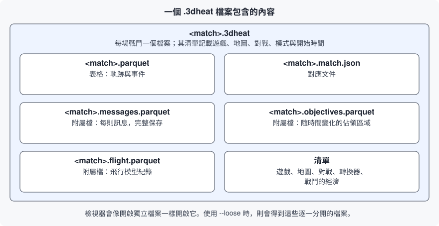
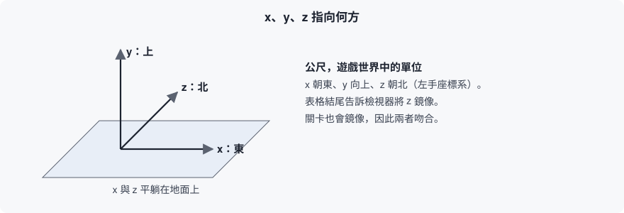

# 輸出檔案 {#output-files}

預設情況下，每場戰鬥是**一個檔案**，即 `out/<map>/<match>.3dheat`：表格、對戰文件與附屬檔案打包在一起，其中的清單會記載遊戲、地圖、對戰、戰鬥模式、開始時間與轉換器（以及 `extensions["heat3d/economy"]` 下的戰鬥經濟）。這個格式屬於檢視器：[每場對戰一個檔案（.3dheat）](https://holdi601.github.io/3DHeat/container.html)。

使用 `--loose` 時，會改為並排寫出相同的檔案：

| 檔案 | 內容 | 頁面 |
|---|---|---|
| `<match>.parquet` | 每個取樣或事件一列 | [表格](table.md) |
| `<match>.match.json` | 回放所記錄的其他一切 | [對戰文件](match-document.md) |
| `<match>.messages.parquet` | 每則訊息、元件數值與封包，完整保存 | [附屬檔案](sidecars.md) |
| `<match>.objectives.parquet` | 隨時間變化的佔領區域 | [附屬檔案](sidecars.md) |
| `<match>.flight.parquet` | 每架飛機的每一筆飛行模型紀錄，完整保存 | [附屬檔案](sidecars.md) |

若打包失敗，獨立檔案會保留，並會在輸出的那一行說明此事。

## 名稱 {#names}

`<match>` 為 `<map>_<AB|RB|SB>_<mode>_<start, UTC>_<session id>`，如圖所示：見[哪些檔案屬於同一場戰鬥](converting.md#which-files-are-one-battle)。`<map>` 是遊戲自己的地圖 id（圖中為 `99_testmap`）。

## 座標 {#coordinates}

單位為公尺，位於遊戲自己的世界中：x 朝東、y 向上、z 朝北。表格結尾會告訴檢視器將 z 鏡像，而 `heat3d-wt-level` 產生的地圖也以相同方式寫出，因此回放與其地圖會疊在一起。

---

屬於 [3DHeat](https://github.com/Holdi601/3DHeat)（[說明文件](https://holdi601.github.io/3DHeat/)）的一部分。來源：[3DHeat-Ext-WarThunder](https://github.com/Holdi601/3DHeat-Ext-WarThunder)。
