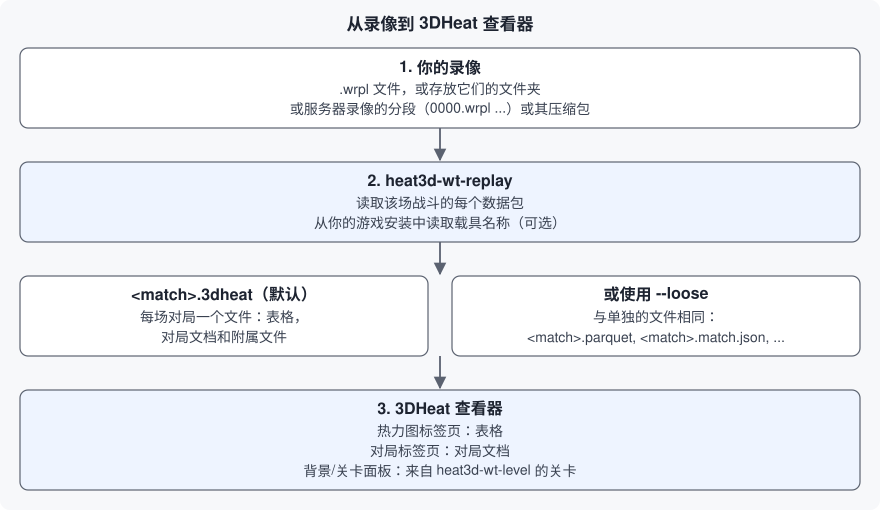

# 3DHeat 战争雷霆录像 {#dheat-war-thunder-replays}

**这是什么？** 战争雷霆可以把一场对局录制成录像文件。本工具会把录像转换成一个文件，你可以在 [3DHeat 查看器](https://holdi601.github.io/3DHeat/) 中从上方观看：每一架飞机、坦克和舰船，每一枚导弹和炸弹，以及每一次命中发生的位置。第二条命令会把你自己游戏安装中的关卡转换成 3D 关卡，用来展示这些对局。

**我为什么要用它？** 用于以 3D 方式复盘一场对局；用于汇总多场对局中你和其他人飞行、驾驶、战斗和阵亡的位置热力图；查看命中落在载具的什么位置；查看一场对局花费了多少、赚取了多少。输出的是普通的 Parquet 和 JSON 文件，其他工具也能读取。

**示例：** 输入一个 `.wrpl` 录像，输出一个 `<对局>.3dheat` 文件：



## 快速开始 {#quick-start}

第一次使用命令行？请先阅读 [开始之前](before-you-start.md)。

```bash
git clone https://github.com/Holdi601/3DHeat-Ext-WarThunder.git
cd 3DHeat-Ext-WarThunder
pip install -e .                                  # 安装 heat3d-wt-replay 和 heat3d-wt-level
heat3d-wt-replay "<War Thunder>/Replays" -o out
```

每场对局会输出一行：`ok out/<地图>/<对局>.3dheat`。在 3DHeat 查看器中打开这个文件。

## 本文档 {#this-documentation}

| 页面 | 内容 |
|---|---|
| [开始之前](before-you-start.md) | Python、终端，以及成功是什么样子 |
| [安装](installing.md) | 安装、来自游戏安装的名称、更新 |
| [转换录像](converting.md) | `heat3d-wt-replay` 的逐步说明，每个选项，消息 |
| [输出文件](output-files.md) | `.3dheat` 文件、`--loose` 文件、命名方式 |
| [表格](table.md) | 每一列和每一个事件 |
| [对局文档](match-document.md) | `<对局>.match.json` 中的每个键 |
| [附属文件与完整性](sidecars.md) | 除表格外完整保存的内容，以及数量统计 |
| [关卡](levels.md) | `heat3d-wt-level`：从你的游戏安装生成 `.glb` 格式的关卡 |
| [工具如何读取录像](how-it-reads.md) | 读取了哪些内容，以及如何检验 |
| [飞机](aircraft.md)、[地面单位与相机](ground.md)、[命中、射击与火灾](hits.md) | 各列背后的详细说明 |
| [经济](economy.md)、[目标](objectives.md) | 银狮与研究点数；占领区、机场 |
| [术语与许可](terms.md) | Gaijin 的条款、来源、测试、许可证 |
| [命令参考](../cli-reference.md)、[列清单](../columns.md) | 由代码生成 |

## 3DHeat 的一部分 {#part-of-3dheat}

本转换器是 [3DHeat](https://github.com/Holdi601/3DHeat) 的工具之一。3DHeat 是一个实时 3D 遥测与录像查看器（[文档](https://holdi601.github.io/3DHeat/)）。查看器会打开 `.3dheat` 文件：表格显示在它的 **热力图** 标签页中，对局文档显示在它的 **对局** 标签页中（[一个对局一个文件](https://holdi601.github.io/3DHeat/container.html)）。每个转换器必须保留的内容：[转换器保留所有内容](https://holdi601.github.io/3DHeat/converters.html)。

**它为什么是一个独立的工具。** `.wrpl` 格式没有公开文档，而 Gaijin 的最终用户许可协议（3.2.2、3.2.9 条）禁止对游戏进行逆向工程，也禁止挖掘不打算展示的数据；它没有提到录像，而录像是游戏本身向玩家展示的。为了让许可问题只影响本转换器，它被放在 3DHeat Watcher 之外：安装了 Watcher 时，Watcher 会对新录像运行它；没有它，Watcher 也能正常工作。

| 工具 | 作用 | 源代码 | 文档 |
|---|---|---|---|
| 3DHeat 查看器 | 在 3D 中显示数据：热力图、录像、赛车分析 | [3DHeat](https://github.com/Holdi601/3DHeat) | [网站](https://holdi601.github.io/3DHeat/) |
| GameFiles | 从游戏自带的文件中提取赛道和关卡 | [3DHeat-GameFiles](https://github.com/Holdi601/3DHeat-GameFiles) | [网站](https://holdi601.github.io/3DHeat-GameFiles/) |
| GameCapture | 赛车遥测，以及从游戏录像重建的关卡 | [3DHeat-GameCapture](https://github.com/Holdi601/3DHeat-GameCapture) | [网站](https://holdi601.github.io/3DHeat-GameCapture/) |
| Unreal Exporter | 一个导出关卡的 Unreal Editor 插件 | [3DHeat-UnrealExporter](https://github.com/Holdi601/3DHeat-UnrealExporter) | [网站](https://holdi601.github.io/3DHeat-UnrealExporter/) |
| CS2 | 反恐精英 2 的对局录像和地图 | [3DHeat-CS2](https://github.com/Holdi601/3DHeat-CS2) | [网站](https://holdi601.github.io/3DHeat-CS2/) |
| Watcher | 在你游玩时记录游戏发布的数据 | [3DHeat-Watcher](https://github.com/Holdi601/3DHeat-Watcher) | [网站](https://holdi601.github.io/3DHeat-Watcher/) |
| 战争雷霆录像 | `.wrpl` 录像和战争雷霆关卡 | [3DHeat-Ext-WarThunder](https://github.com/Holdi601/3DHeat-Ext-WarThunder) | [网站](https://holdi601.github.io/3DHeat-Ext-WarThunder/) |
| 坦克世界录像 | `.wotreplay` 录像 | [3DHeat-Ext-WoT](https://github.com/Holdi601/3DHeat-Ext-WoT) | [网站](https://holdi601.github.io/3DHeat-Ext-WoT/) |
| 战舰世界录像 | `.wowsreplay` 录像 | [3DHeat-Ext-WoWs](https://github.com/Holdi601/3DHeat-Ext-WoWs) | [网站](https://holdi601.github.io/3DHeat-Ext-WoWs/) |
| Squad 录像 | Squad 服务器录像 | [3DHeat-Ext-Squad](https://github.com/Holdi601/3DHeat-Ext-Squad) | [网站](https://holdi601.github.io/3DHeat-Ext-Squad/) |
| DCS 地图 | DCS World 地图，转换为 3D 关卡 | [3DHeat-Ext-DCS](https://github.com/Holdi601/3DHeat-Ext-DCS) | [网站](https://holdi601.github.io/3DHeat-Ext-DCS/) |
| IL-2 地图 | IL-2 Great Battles 地图，转换为 3D 关卡 | [3DHeat-Ext-IL2](https://github.com/Holdi601/3DHeat-Ext-IL2) | [网站](https://holdi601.github.io/3DHeat-Ext-IL2/) |

---

本页是 [3DHeat](https://github.com/Holdi601/3DHeat) 的一部分（[文档](https://holdi601.github.io/3DHeat/)）。来源：[3DHeat-Ext-WarThunder](https://github.com/Holdi601/3DHeat-Ext-WarThunder)。
