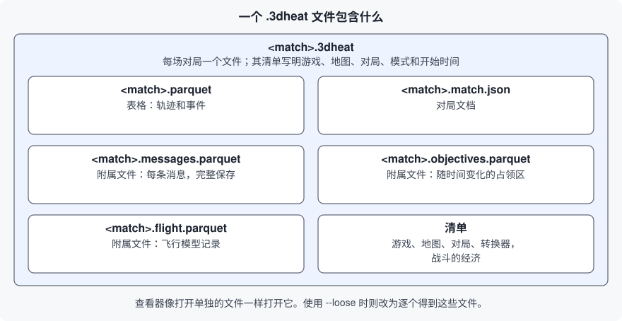
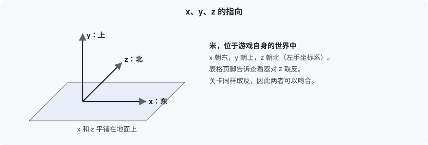

# 输出文件 {#output-files}

默认情况下，每场对局是 **一个文件**，即 `out/<地图>/<对局>.3dheat`：表格、对局文档和附属文件打包在一起，附带一份清单，写明游戏、地图、对局、战斗模式、开始时间和转换器（以及该场对局的经济数据，位于 `extensions["heat3d/economy"]` 下）。格式属于 3DHeat 查看器：[一个对局一个文件（.3dheat）](https://holdi601.github.io/3DHeat/container.html)。

使用 `--loose` 时，同样的文件会改为并排单独保存：

| 文件 | 内容 | 页面 |
|---|---|---|
| `<对局>.parquet` | 每个采样或事件一行 | [表格](table.md) |
| `<对局>.match.json` | 录像里其余的全部信息 | [对局文档](match-document.md) |
| `<对局>.messages.parquet` | 每条消息、组件数值和数据包，完整保存 | [附属文件](sidecars.md) |
| `<对局>.objectives.parquet` | 随时间变化的占领区 | [附属文件](sidecars.md) |
| `<对局>.flight.parquet` | 每架飞机的每条飞行模型记录，完整保存 | [附属文件](sidecars.md) |

如果打包失败，单独的文件会被保留，并且输出行会说明这一点。

## 名称 {#names}

`<对局>` 的格式是 `<地图>_<AB|RB|SB>_<模式>_<开始时间，UTC>_<会话 ID>`，见图片：参见 [哪些文件属于同一场对局](converting.md#which-files-are-one-battle)。
`<地图>` 是游戏为地图设定的 ID（图片中为 `99_testmap`）。

## 坐标 {#coordinates}

单位为米，在游戏自身的世界中：x 朝东，y 朝上，z 朝北。表格的页脚会告诉查看器对 z 取反，`heat3d-wt-level` 输出的关卡也采用同样的方式，因此录像和它的关卡能够准确地叠合在一起。

---

本页是 [3DHeat](https://github.com/Holdi601/3DHeat) 的一部分（[文档](https://holdi601.github.io/3DHeat/)）。来源：[3DHeat-Ext-WarThunder](https://github.com/Holdi601/3DHeat-Ext-WarThunder)。
